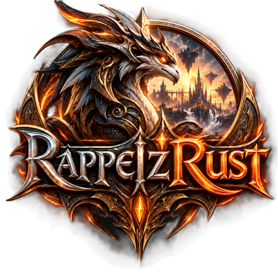

<p align="center">
  
</p>

<p align="center">
  <a href="https://discord.gg/RPtfV6GjZz"></a>
</p>

<p align="center"><a href="README.md">English</a> · <b>Français</b></p>

# RappelzCore & RappelzRust

Émulateur de serveur **Rappelz** (RappelzCore) et client de jeu (RappelzRust), en Rust, reconstruits
par rétro-ingénierie (REA / Ghidra) du client **Rappelz NoLimits** (`Rappelz NoLimits\SFrame.exe`).
Le lanceur indique 1.3.60 ; l'Epic et le patch exacts du binaire restent indéterminés
(voir les [preuves relevées](docs/CLIENT_REVERSE_ENGINEERING.md)).

Cette continuation ajoute une **base d'addons Lua 5.1 fonctionnelle**, un gestionnaire natif,
un sous-ensemble XML et l'addon RappelzDebug avec paramètres persistants. Le
[bilan de développement](docs/DEVELOPMENT_STATUS.md) et la
[matrice des API](docs/LUA_API_COMPATIBILITY.md) précisent les fonctionnalités testées et les limites.
La [validation native locale](docs/LIVE_SERVER_VALIDATION.md) et le
[combat/EXP à deux clients](docs/COMBAT_VALIDATION.md) confirment les événements, dégâts synchronisés,
montées de niveau par EXP et données préservées. Le [suivi des réapparitions](docs/RESPAWN_VALIDATION.md)
ajoute les combats répétés et le refus des requêtes hors visibilité. La [mort/résurrection du joueur](docs/REVIVAL_VALIDATION.md)
vérifie désormais son rendu et sa position chez l'observateur ainsi que les événements Lua.
Le [suivi des déplacements](docs/VISIBILITY_VALIDATION.md) reprend les trajets lors des apparitions et vérifie les sorties de portée.
L'espace de développement combiné passe 94 tests Rust et 14 tests Python ; chaque branche conserve son périmètre serveur/client compilable.

- **RappelzCore** utilise **exactement le schéma SQL d'AzerothCore** (`acore_auth`, `acore_characters`,
  `acore_world`, importé du dépôt officiel, commit `3179ea3` du 25/10/2026), son format de configuration
  (`authserver.conf`, `worldserver.conf`, variables `AC_*`), son hachage SRP6 des mots de passe et sa
  console. Un compte créé par AzerothCore fonctionne ici, et inversement.
- **RappelzRust** range ses ressources **comme un client World of Warcraft 3.3.5** : archives **MPQ**
  (`Data/common.MPQ`, `Data/common-2.MPQ`, `Data/frFR/locale-frFR.MPQ`), bases client **DBC**
  (`DBFilesClient\*.dbc`), `realmlist.wtf`, `WTF/Config.wtf`.
- Les deux parlent le **protocole réseau du client Rappelz d'origine** : RappelzCore vise aussi le
  client NoLimits officiel (voir « Limites »).

## Branches

| Branche | Contenu |
|---|---|
| `RappelzCore` (par défaut) | **RappelzCore**, le serveur : `authserver`, `worldserver`, `rz-dbimport`, schéma SQL AzerothCore (`sql/`), configuration (`conf/`), crates partagées nécessaires (protocole, base de données, formats Rappelz), outils `rz-extractor` (données serveur) et `rz-bot` (tests). |
| `RappelzRust` | **RappelzRust**, le client : `RappelzRust.exe`, `rz-extractor` (client Rappelz → MPQ/DBC), `rz-bot`, crates de rendu et de formats (textures, terrain, modèles, interface) et crates partagées. |

Chaque branche compile seule (`cargo build --release`). Les fichiers du jeu (client Rappelz,
archives converties) ne sont pas versionnés : il faut un client Rappelz NoLimits pour les produire.

## Arborescence

```
Cargo.toml                    espace de travail
shared/
  rz-common/                  configuration .conf (AzerothCore), journalisation
  rz-mpq/                     MPQ v1 : lecture, écriture, chaîne de patchs (format WoW)
  rz-dbc/                     WDBC : lecture, écriture, chaînes de format façon DBCfmt.h
  rz-rappelz/                 formats Rappelz d'origine : data.000-008, .rdb → .dbc, DBC par nom de champ
  rz-proto/                   protocole : RC4 « XRC4 », RSA/AES, messages TS_* (msg.rs, msg_game.rs)
  rz-database/                MySQL (sqlx) sur le schéma AzerothCore, SRP6
  rz-texture/                 textures : DDS (DXT1/3/5, non compressé), TGA, JPEG, PNG, BMP
  rz-terrain/                 cartes nFlavor : .nfm (relief, textures, décors), .nfw, .nfa, .qpf, .nfs…
  rz-model/                   modèles .nx3 (BTRF/KNIB), animations .naf, objets .cob, assemblage
  rz-ui/                      interface d'origine : sprites .spr, fenêtres .nui, règles de dessin
RappelzCore/
  authserver/                 → authserver.exe
  worldserver/                → worldserver.exe (lobby, monde, visibilité, chat, commandes GM, console)
  tools/rz-dbimport/          DBC → tables acore_world
RappelzRust/
  client/                     → RappelzRust.exe (macroquad)
  tools/rz-extractor/         client Rappelz → installation RappelzRust (MPQ/DBC) ; extraction DBC serveur
  tools/rz-bot/               client de test sans interface
sql/
  base/db_auth|db_characters|db_world/   schéma AzerothCore (world : structure seule)
  custom/                     ajouts RappelzCore (royaume par défaut)
  create/create_mysql.sql     utilisateur et bases (comme AzerothCore)
conf/                         authserver.conf.dist, worldserver.conf.dist
docs/re/                      rétro-ingénierie : archive, RDB, protocole (+ scripts Node de validation)
tools/                        import du schéma AzerothCore, génération des schémas RDB
```

## Compilation

```bash
cargo build --release
```

Binaires dans `target/release/` : `authserver`, `worldserver`, `RappelzRust`, `rz-extractor`,
`rz-dbimport`, `rz-bot`. Tests : `cargo test` (certains tests lisent le vrai client s'il est présent
dans `Rappelz NoLimits/`).

## Mise en route

### 1. Convertir le client Rappelz en client RappelzRust

```bash
target/release/rz-extractor client --client "Rappelz NoLimits" --out client-data/RappelzRust --locale frFR --codepage windows-1252
target/release/rz-extractor verify --client "Rappelz NoLimits" --data client-data/RappelzRust/Data
```

6,4 Go → 3,5 Go de MPQ en ~40 s ; `verify` compare les 125 212 ressources octet par octet.
Copiez ensuite `RappelzRust.exe` dans `client-data/RappelzRust/`.

### 2. Données du serveur (comme le map_extractor d'AzerothCore)

```bash
target/release/rz-extractor dbc --data client-data/RappelzRust/Data --out <DataDir>
```

### 3. Bases de données

```bash
mariadb -uroot -p < sql/create/create_mysql.sql
tools/sql/import_all.sh 127.0.0.1 3306 acore acore
target/release/rz-dbimport --data-dir <DataDir> --apply "127.0.0.1;3306;acore;acore;acore_world"
```

`rz-dbimport` remplit `item_template` (34 682), `creature_template` (+ `creature_template_model`),
`creature` (1 497 PNJ placés), `quest_template` (986) et `game_tele` (407) à partir des DBC.

### 4. Serveurs

Copiez `conf/*.conf.dist` en `authserver.conf` / `worldserver.conf` (adaptez `*DatabaseInfo` et
`DataDir`), puis :

```bash
authserver -c authserver.conf      # port 4615 (auth_port du launcher NoLimits)
worldserver -c worldserver.conf    # port 4514 (= realmlist.port)
```

Console du worldserver : `account create <compte> <mdp>`, `account set gmlevel <compte> 3`,
`account set password …`, `announce …`, `server info`, `saveall`, `exit`.

### 5. Jouer

```bash
RappelzRust.exe                      # dans le dossier de l'installation (Data/, WTF/)
RappelzRust.exe -demo                # monde hors ligne avec les PNJ de NpcResource.dbc
```

Adresse de l'authserver : `Data/frFR/realmlist.wtf` (`set realmlist 127.0.0.1[:port]`).
Volumes : `SET Sound_MusicVolume "0.5"` / `SET Sound_SFXVolume "0.7"` dans `WTF/Config.wtf`.

Le client affiche les ressources d'origine : fenêtres `.nui` du lobby et du HUD (connexion, serveurs,
personnages, jauges, chat, raccourcis, menu, inventaire, dialogue PNJ), relief et textures de sol des
cartes, décors (`TerrainPropInfo.cfg` → `.cob` → `.nx3`), personnages, PNJ et monstres animés
(`.nx3` + `.naf`, skinning), écrans de chargement, musiques et sons.

En jeu : ZQSD/WASD ou clic droit au sol pour se déplacer, clic gauche glissé pour la caméra, molette
pour le zoom ; clic gauche sur une créature = cible, clic droit = attaquer (monstre) ou parler (PNJ) ;
`I` = inventaire (clic droit : équiper/retirer, Maj+clic avec une boutique ouverte : vendre) ;
Entrée pour le chat (`/w nom msg`, `/y msg`, `.help`), Échap ferme les fenêtres puis renvoie au lobby.
Commandes : `.gps`, `.online`, `.save`, `.server info`, `.tele <lieu>`, `.go x y`, `.appear`,
`.summon`, `.announce`, `.level`, `.money`, `.additem <id> [n]`, `.spawn <monstre> [respawn]`
(ajoute un point d'apparition dans `creature`), `.vendor add <objet>` (boutique du PNJ le plus proche,
table `npc_vendor`) — selon le niveau GM d'`account_access`.

## Correspondance des données Rappelz ↔ AzerothCore

| Rappelz | AzerothCore |
|---|---|
| compte, mot de passe | `account` (username en majuscules, `salt`/`verifier` SRP6) |
| clé one-time auth → jeu | `account.session_key` (8 premiers octets) |
| serveurs | `realmlist`, `realmcharacters` |
| personnage | `characters` : race (3 Gaia, 4 Deva, 5 Asura), `gender` = sexe − 1, `class` = classe de base du métier, `level`, `xp`, `money` (rupees), position |
| métier, niveau de métier, JP, apparence | `character_settings` (`source = 'rappelz'`) |
| objets, monstres, PNJ, quêtes, lieux | `item_template`, `creature_template`, `creature`, `quest_template`, `game_tele` |
| inventaire et équipement | `item_instance` + `character_inventory` (slot 0–27 = emplacement porté, ≥ 28 = sac) |
| boutiques des PNJ | `npc_vendor` (entry = 1 000 000 + id NpcResource) |
| monstres placés | `creature` (entry = id Monster.dbc), réapparition `spawntimesecs` |
| bases client .rdb | `DBFilesClient\*.dbc` (WDBC), lus par le worldserver dans `DataDir/dbc` |

Contraintes héritées du schéma : noms de personnage de 12 caractères max (`characters.name`),
mots de passe de 16 caractères max (règle AzerothCore).

## Rétro-ingénierie (docs/re)

- `data_archive.md` : index `data.000` XORé, encodage des noms, hachage vers `data.001-008`,
  extensions en clair. Lecteur Rust : `shared/rz-rappelz/src/archive.rs`.
- `rdb_format.md` : en-tête de 132 octets, 23 schémas de tables validés jusqu'au dernier octet,
  `db_string`, `db_item.ref`, ids de monstres bit-permutés.
- `network_protocol.md` : en-tête de 7 octets + checksum, RC4 à KSA non standard (drop 1013),
  RSA-1024 + AES-128-CBC pour le mot de passe et la clé one-time, paquets du flux de connexion,
  monde, chat, ENTER (ids brouillés), STAT_INFO ; §9 : 52 messages de gameplay (inventaire,
  équipement, PNJ, boutique, compétences, quêtes, combat).
- `terrain_format.md` : `.nfm` v16/v22 (relief 384×384, couches de textures, décors, herbe), fichiers
  associés et `.cfg` ; repère monde vérifié (continuité des bords, position des PNJ).
- `model_format.md` : conteneurs BTRF/KNIB et gabarits `nx3.tml`, maillages, matériaux, squelettes,
  animations (4800 ticks/s), `.cob`, assemblage des personnages (`db_DefaultModelRes`, `db_item`).
- `ui_format.md` : `.spr` texte/binaire, `.nui`, règles de dessin (1/3/9 images, états), légendes
  `<$id>`, fenêtres de chaque écran.

## Vérifications des développements précédents

Cette liste contient des résultats conservés des travaux précédents. Les vérifications du
30–31/10/2026 (94 tests Rust réussis, compilation optimisée et 125 212 ressources identiques) sont séparées
des anciens résultats serveur/base de données dans [DEVELOPMENT_STATUS.md](docs/DEVELOPMENT_STATUS.md).

Pour installer l'addon sur un client déjà converti :
`target/release/rz-extractor addons --out client-data/RappelzRust` (les fichiers existants sont conservés).
Le bouton **AddOns**/F9 ouvre le gestionnaire ; `/reload` recharge l'interface depuis le chat en jeu.
Voir [LUA_ADDON_SYSTEM.md](docs/LUA_ADDON_SYSTEM.md) pour le périmètre pris en charge.

- Tests unitaires (vecteurs RC4 et checksum tirés du binaire, tailles des 20 paquets observés,
  MPQ/StormLib, DBC, SRP6, RDB sur les vrais fichiers).
- Conversion complète du client et vérification octet par octet.
- Schéma AzerothCore importé sans erreur dans MariaDB 13 ; import des données du monde.
- Parcours complet avec deux `rz-bot` simultanés et avec le client graphique : authentification,
  royaume, création de personnage, entrée en jeu, visibilité joueurs/PNJ, déplacements, chat,
  commandes GM, sauvegarde et déconnexion ; données vérifiées en base.
- Gameplay avec `rz-bot` : `.additem` → inventaire, équipement (`ITEM_WEAR_INFO` + `WEAR_INFO`),
  dialogue PNJ → boutique → achat (rupees débitées), monstre placé par `.spawn` → combat dans les
  deux sens → mort du monstre → récompenses Monster.dbc ; objets, boutique et monstres persistent
  après redémarrage.
- Rendu vérifié par captures (`-screenshot`) : lobby et HUD d'origine, Laksy en 3D (bâtiments,
  pavés, PNJ animés), monstre envoyé par le serveur affiché avec son modèle.
- Formats : 22 061/22 072 nx3, 20 825 naf, 4 311/4 312 cob, 106 cartes, 485 `.nui` relus ;
  textures DDS/TGA décodées sans échec sur l'échantillon testé.

## Limites connues

- Rendu : pas encore d'eau (`.nfw`), d'herbe procédurale, d'effets (`rcfx`, `.spt`), de ciel ni
  de brouillard ; armes et accessoires pas encore accrochés aux os ; éclairage simplifié pour les
  modèles. Les pièces d'armure remplacent les parties nues d'après leur nom de fichier.
- Interface : les fenêtres sont celles du jeu, mais leurs positions à l'écran sont choisies par
  RappelzRust (le client d'origine les fixe dans son code) ; l'écran de création de personnage, la
  boutique et l'équipement détaillé utilisent encore des panneaux simples.
- Gameplay serveur : combat au corps à corps avec formules provisoires (en attendant db_BasicStat /
  db_Exp), récompenses EXP/JP/rupees, mort et réapparition ; pas encore de compétences, de quêtes,
  de groupe, de butin au sol ni d'IA de monstres agressifs.
- Le client NoLimits d'origine n'a pas été testé contre RappelzCore. Il doit être lancé par son
  launcher (`<process>_RUNNER`). Le KSA RC4 a été lu en assembleur sans capture réelle pour le
  confirmer. Plusieurs champs de paquets de gameplay sont déduits (marqués [D] dans la doc).
- La sémantique de plusieurs champs RDB est déduite (positions prouvées, sens parfois inconnu).

## Licence

GPL-2.0-or-later. Le schéma SQL de `sql/base` provient
d'[AzerothCore](https://github.com/azerothcore/azerothcore-wotlk) (GPL-2.0). Rappelz est une marque
de ses propriétaires respectifs ; aucun fichier du jeu n'est distribué.
