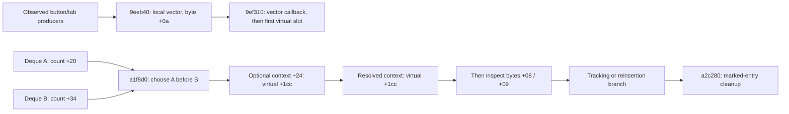

# SFrame message queues, callbacks and character-window lifecycle

Verified **2026-11-01**, statically on the same supplied SFrame SHA-256 `27f42fc8f6b08df8c239640b938d601aeaebb7b3db0c89fc47755325a98a410d`. **REA 6.4.0 / Ghidra 12.1.4** returned **23 retained function dossiers / 21,873 analyzed body bytes** across two focused sessions. No original SFrame process was launched. Recovered pseudocode and signatures are decompiler observations, not original source or a runtime trace.

This pass extends [the stat-bank investigation](SFRAME_STAT_BANKS_RE.md): character-window reset/selection, local message delivery, two deque banks, callback hooks and selected queue-lifecycle operations are now explicit. Some concrete receivers and the activation of a nonzero alternate UI mode remain unknown. The original server's stat-pair order and bonus formulas are not established by client routing.

Versions remain [documented separately](VERSIONS.md): RappelzRust/Core **0.1.0 development**; original Rappelz NoLimits launcher **1.3.60**, SFrame PE metadata **9.1.0.0**, build label **Source9.5.2**, network literal **201507080**. The exact official Epic/patch and full original-client interoperability remain unconfirmed.

## Character window: tabs are distinct from target mode

The main constructor **0x008a19f0** installs the `SUICharacterInfoWnd` vtable and initializes tab index **+0x454**, mode byte **+0x458** and selected handle **+0x45c** to zero. Initialization **0x008a1ab0**, original RTTI and loading strings bind child **+0x44c** to `SUICharacterInfoSubBasicWnd` and **+0x450** to `SUICharacterInfoSubAddedWnd`. Their resources are `window_player_character_info_sub_basic.nui` and `window_player_character_info_sub_added.nui`.

**0x008a3500** selects **0=Basic / 1=Added**, stores +0x454 and updates the matching controls. It does not set the alternate-mode byte. The direct tab event consumer **0x008a23d0** recognizes event 10 and the original names `tab_basic_01`/`tab_added_01`. These are two panels, not proof of a player/summon toggle. The Added branch creates a local internal kind **0xa4**, RTTI label `SMSG_INSTANCE_GAME_SCORE_REQUEST`, and posts it through 0x009eeb40; that is not itself a recovered wire opcode or proof of server communication.

The virtual visibility method **0x008a1d40**, identified at main vtable slot **+0xdc**, clears **+0x458/+0x45c in both branches**. On opening it reapplies the current tab index and refreshes the child panels. Closing clears the mode and target but does not reset the tab index in this method. The close button creates a local kind **0x3f9**, window ID **0x2e**, requested state 0; it is also posted to the local vector.

The alternate refresh **0x008a30f0** first takes +0x45c, then falls back to the state field at **[this+0x424]+0x208** when zero. It requires a nonzero handle, successful actor lookup and nonnull actor data before retaining the resolved handle. It refreshes public actor-facing fields, puts the literal **“-”** into EXP/JP displays, resets the EXP gauge, refreshes primary/derived values and calls the two plus renderers with zeroed **16/82-byte inputs**. These are internal object fields, not wire offsets or proposed Rust layouts.

The separate state setter **0x006d95b0** writes handle+0x208, a string at+0x210 and a byte at+0x244. Its callers in the retained main handler include internal kind 0x403; the zero-handle path clears that state. This connects the fallback to an explicit cache setter, without asserting every original selection/authorization rule.

**Activation remains open:** a bounded direct-field inspection of **0x8a19f0–0x8a3740** finds zero initialization/resets and reads of+0x458, but no direct nonzero assignment. Aliased, copied or external writes are not excluded. The presence of an alternate-mode reader is not proof that its full runtime lifecycle has been reconstructed.

## Three local delivery structures and their order

For clarity, **P** denotes the processing object, and **Q** denotes its separate queue-owner object reached at **P+0x08**. The routine **0x009eeb40** sets internal message byte **+0x0a=1** and appends its pointer to P's vector **[+0x44,+0x48)**. Under the inspected nonnull-context branch, **0x009ef310** drains that local vector before its deque loop, calls the resolved context's virtual **+0x1cc**, then invokes each message's first virtual slot with argument 1 and clears the vector end. The call convention resembles deleting destruction; every destructor implementation is not reconstructed here. This local vector is distinct from the two deque banks below.

Both **0x00a350d0** and **0x00a35160** append at the tail of their receiver deque, growing its block map when necessary. Their layouts are equivalent; the helper name alone does not identify which producer/receiver instance is using it. The dequeue **0x00a1f8d0** prioritizes Q counter **+0x20** (bank A), otherwise Q counter **+0x34** (bank B). It reads the current front index, decrements the count and resets/advances that index. Bank A removal additionally increments message DWORD **+0x0f**; bank B removal does not do so in this function. The full semantic name of that counter is not established.

This demonstrates per-bank tail/front behavior and explicit A-over-B priority, **not one global FIFO across every source**. It does not establish a legal server order for type 0/type 1 pairs.

The two virtual deliveries in the deque path occur **before** the pump's subsequent handled-byte decision; there is no intervening handled-byte short circuit in that pump block. That does not prove two distinct receiver instances, nor that a specific UI object receives each message. Individual receivers can filter internally. **0x009eed60** also has its own special cases and a forwarding path to a resolved context.

## Handled, auxiliary tags and reinsertion are separate

All offsets here concern **internal messages/containers**, not the seven-byte network header. In 0x009ef310 the post-callback branches are:

| Internal condition | Selected method | Observed operation |
|---|---|---|
| handled byte +8 is nonzero | 0x00a1f6b0 | Append pointer to tracking vector ending at Q+8. |
| byte +9==1 and handled+8==0 | 0x00a1f710 | Append pointer to a different tracking vector ending at Q+0x50. |
| Other unhandled message | 0x00a1f6e0 | Reinsert through the deque at Q+0x10. |

For the last method, the native assembly explicitly adjusts **ECX (Q) by+0x10** before calling 0x00a35160. Together with the dequeue layout this identifies the first/A deque; the implicit-this adjustment is easy to miss in pseudocode alone. It additionally marks handled+8 for the **internal kind range 0x3eb–0x3f7** before reinsertion. This is not a rule for the numerically equal **wire** opcodes.

**0x00a2c280** walks two tracking ranges, invokes a message's first virtual slot when its handled byte is set and removes that entry. **0x00a2c340** only assigns a supplied tick value to receiver+0x58; it is not a queue flush. These selected operations do not establish global ownership, fairness, a lifetime contract or an exactly-once guarantee. Byte+0x0a from the local-vector producer, byte +9, handled+8 and DWORD+0x0f must not be conflated.

## The stat branch has an optional callback prepass

The retained large handler **0x006d2e60** first calls 0x006da6a0, then calls **0x0071adf0** if its+0x120 receiver exists, before its main kind switch. An independent original-byte jump-table check shows that **kind 0x1f** maps directly to 0x006da6a0's epilogue; that selected prepass does no stat work. The optional registry is a different path.

**0x0071bd70** resolves an exact integer key supplied from message+4. When found, 0x0071adf0 enumerates the associated callback-pointer list and reaches the **0x0071ade9** thunk, which dispatches virtual **+0x0c**. This loop contains no handled+8 test between callbacks. Callback registration, actual runtime recipients and mutation of a callback list during dispatch remain outside this pass. Ghidra explicitly reports that it cannot recover the thunk's indirect jump targets; that warning is retained.

The main switch's **kind 0x1f** then calls **0x006d2b70**, the stat-bank/cache route analyzed in the previous pass. This connects the optional prehook and the explicit stat branch, but **does not establish that all UI updates occur after the bank writes**. The concrete registered callback recipients would be needed for that claim.

Another helper, **0x006e12e0**, checks receiver+4 and calls its virtual+0x128, returning whether the receiver was present. Its concrete destination is still unresolved. Whole-file searches for eight exact absolute 32-bit entry-address patterns found no matches; this is a bounded negative search, not proof that dynamic routing is absent. Observed adapters adjust their receivers before reaching 0x009eeb40,0x009eed60 or0x009ef310. They do not justify substituting those receivers for this helper's receiver+4.

## Fresh native Evidence and transport recovery

| Analyzed inclusive body | Bytes | Role | Evidence ID |
|---|---:|---|---|
| 0x8a3500–0x8a364e | 335 | Basic/Added tab selection | `ev_a4b453f0e7c50f8457c67db0e7c4379d6645e67044af83a62c0e95472cc3a20c` |
| 0x8a30f0–0x8a34f9 | 1034 | Selected-actor refresh and contribution clearing | `ev_295a9ba6abb1926edf4a6b5e4cc827f166f4a84d714ca3efa0c8d65301b94b1a` |
| 0x8a1d40–0x8a1dc2 | 131 | Visibility method and context reset | `ev_10e965f99af0876e0d108b0ba4bfd7820f456137fa2b9dfde61ae54ea385f824` |
| 0x8a19f0–0x8a1a34 | 69 | Character-window constructor | `ev_f3a4ff37e3949c13ed452102ee534729623efb381bd564fe0da8330bbded3cd2` |
| 0x8a1ab0–0x8a1c0c | 349 | Basic/Added child initialization | `ev_6d832c9d0196d2b1898603d93fd01bcd02fc3ba1df5750e51a235611f561c24c` |
| 0x8a23d0–0x8a25e3 | 532 | Button/tab event consumer | `ev_550dc95b0cabda6eff467bede9e41278f11fa94fcef1bb72d91e222a2bcbdcc0` |
| 0xa350d0–0xa35155 | 134 | First retained deque append implementation | `ev_feb1175ff4fa2a196e2eefa57f093ce131ce511c28afb2825a39a07b608d0cdd` |
| 0xa35160–0xa351e5 | 134 | Second retained deque append implementation | `ev_485d175923499ea99b2ed1888c7bd3287970b25ee550a385724b1c531902628b` |
| 0xa1f8d0–0xa1f974 | 165 | Two-bank priority dequeue | `ev_ddde4d8eee2c71660bbc81891cc0e9390d9caf342912cbbd5e742015ec00853b` |
| 0x6e12e0–0x6e1300 | 33 | Unresolved receiver virtual forwarding helper | `ev_01748e8cdadca1d0f3c05cc260928725fb02f58ba99c7a8adb436426a9438926` |
| 0x9eed60–0x9eee30 | 209 | Generic context-forwarding handler | `ev_d0f4ff91dfb57edb09298d35b4d2667c9306a8ec78708e3faba1b0e93209a173` |
| 0x9ef310–0x9efda5 | 2710 | Main local/vector/deque processing routine | `ev_ffe72a961a6d1f07a45da8b6a46d3beb3fd3fdfb28c4e9486ac8de134da29df3` |
| 0x6d2e60–0x6d6ac5 | 15462 | Main game handler and stat case | `ev_fa1ee105ef0903e3dc5557eefb2f942ec98d648267ae688d726e620f727a61c5` |
| 0x71adf0–0x71ae5a | 107 | Optional kind-keyed callback dispatch | `ev_0a34a650030ec22bb35d9fe24ec67b2555133ec3c97ad045f16a825ea5e46b2b` |
| 0x71ade9–0x71aded | 5 | Callback virtual+0x0c thunk | `ev_e692a9d8e49f3ec0fdcffdfe049e0fecf050b29828d8bb9fcfdf7292e81ae919` |
| 0x71bd70–0x71bdb6 | 71 | Exact kind-key lookup | `ev_34a09b362bb5418dd5432506c27c916e15d6e1f2ece79766167b2442f9c17675` |
| 0x9eeb40–0x9eeb6c | 45 | Local vector producer | `ev_f1dc736455bf4e490116d08bee86f74588317ce0d3d8eefdaa12e0e7415c9aee` |
| 0xa1f6b0–0xa1f6d8 | 41 | Handled-message tracking append | `ev_baffb11fd0bd7a5b0ab2bdbfa31b824f20c789d8ea45109faf484958e608e726` |
| 0xa1f6e0–0xa1f706 | 39 | Unhandled-message first-deque reinsertion | `ev_df17dec4a26528445c32d05bc01a1cd1269e5a7f3db5cbdff5884cd7ebae2b96` |
| 0xa1f710–0xa1f738 | 41 | Tagged-unhandled tracking append | `ev_86f59605906154b1666a3bff97ed0c567b38d6cd2a6e852b023744d424c72867` |
| 0x6d95b0–0x6d95ec | 61 | Fallback-handle/name/byte setter | `ev_46dd4926c71fcb9aa11feab5fbb357c36fce71dadcd2f37c121c457ce29f0fc6` |
| 0xa2c340–0xa2c34c | 13 | Tick-field assignment | `ev_b737d400b291ae858e51ba18472b0d339efc5f8ba26aa32f0bdd40a5da0b87ef` |
| 0xa2c280–0xa2c318 | 153 | Marked-entry cleanup | `ev_c0c0fa78577e5123caffad666c0a16c1dfe20fe27aac8ae64df96cfb4235ae03` |

All records bind to the original SHA and analysis-profile digest `b9d116ea480a02cc8773b19372074a3caf77785cbc080b1ac7133b5110e40b17`. The graph for **0x6d2e60** is truncated with **40 known omitted edges**; **0x9ef310** is also truncated, with 0 known omitted edges. Both report an omitted-operation lower bound of 1. The remaining 21 value-flow records report untruncated. Complete analyzed body ranges, raw instructions/pseudocode and provider warnings are retained; indirect target resolution, terminal-flow flags and inferred signatures remain separate limitations. A complete retained dossier is not a claim of complete value-flow or source equivalence.

The first long-lived REA session completed **13 native analyses**. Its main-handler result exceeded the stdio result budget **10,484,736 bytes**; the reported lower bound was 10,504,457 bytes. The operation had completed and its full Evidence `ev_fa1ee105ef0903e3dc5557eefb2f942ec98d648267ae688d726e620f727a61c5` remained retained. The complete **16,012,358-byte /13-record** bundle was exported before cleanup and validated using the public **inspect-evidence-bundle** CLI. The exact retained record was recovered **without repeating that analysis**. Transport completeness does not remove its high-p-code truncation.

A second focused session queried **10 different functions**, including the setter left unattempted by the first loop and newly identified callback/queue helpers. The first queries took 397.09 and 410.61 seconds including default Ghidra initialization; both used the same installed public REA launcher with bounded 900-second deadlines. There were no duplicate function-query producers across the two sessions. Its closed snapshot retains 10 primitive entries / 10 Evidence records (7,322,337 bytes). The resource-constrained delivery envelope, complete export, recovery metadata and successful second session remain separately retained. Both owned analysis sessions are closed.

Independent checks validate **123 PE instruction/string/range anchors**, **seven exact vtable/RTTI links**, **five static candidate-interval hashes**, the selected no-op switch mapping and eight bounded absolute-pointer searches. Original source/installed image/addon/WTF hashes and primary service identities are unchanged. All **nine original data-preservation checks** pass. The original files were not executed or modified; no Rust/server behavior, schema, data or package version changes are introduced by this documentation pass. Previous runtime test counts remain historical.

Raw analysis remains ignored under `client-data/audit/2026-11-01-sframe-dispatch-5e2029d3/`, including `phase2/`. Only documentation is published to both branches. Current versions remain prominent in both READMEs and VERSIONS.md.

## Remaining questions

The local primitives, priority, selected callback order, tab/reset behavior and fallback-field setter are established for the inspected paths. The broad questions are **partially answered**: nonzero alternate-mode activation, exact producer-to-deque instance bindings, registered callback identities and the complete UI/world fanout remain unresolved. The server's legal stat-pair sequencing, contribution coefficients and original runtime interoperability remain unknown. Follow concrete registration/construction sites or authorized runtime evidence next; do not infer server stat generation or an inspection permission policy from these local queues/getters.

## Follow-up: concrete owners and separate target-info activation, 2026-11-01

[SFRAME_MODE_RECIPIENTS_RE.md](SFRAME_MODE_RECIPIENTS_RE.md) closes the selected initialized forwarding route through SGameWorld, SGameManager and SGameInterface, identifies SHuntaHolicSystem’s constructor registrations, and recovers the target-info button → internal command/show request → distinct window 0x5d path. The old broad receiver uncertainty above is narrowed for these concrete paths. The main window’s nonzero +0x458 setter is still unresolved; the target window’s own+0x450 is not that field. Callback constructor kind 31 absence is bounded and does not prove the full live registry or all UI-after-bank ordering. The larger scan, false positives, exact Evidence and retained graph limits are documented in the follow-up; original files, data, services and software/game versions are preserved.
