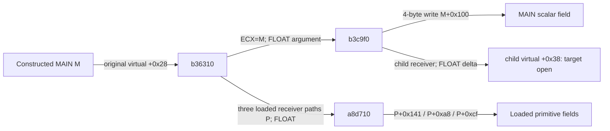

# SFrame interprocedural values and MAIN helper contracts

Follow-up **2026-11-02**: [MAIN child opacity callbacks](SFRAME_MAIN_OPACITY_CALLBACKS_RE.md) qualifies the selected child virtual38→64→28 continuation and its loaded-object effects. Four new Native bodies are separate from this report’s frozen555-root model; the receiver of918630 and MAIN458 trigger remain unresolved.

Verified **2026-11-02**, following the [caller/descendant audit](SFRAME_ENTRY_AND_DESCENDANTS_RE.md), on original x86 SFrame SHA-256 **`27f42fc8f6b08df8c239640b938d601aeaebb7b3db0c89fc47755325a98a410d`**. **The actual receiver of 0x918630 and the nonzero trigger of MAIN+0x458 remain unidentified.** This pass adds a real bounded call/return extension to the former intra-procedure model and **2 new Native helper dossiers / 160 analyzed bytes** on a constructed MAIN call chain.

[Versions](VERSIONS.md) remain Core/RappelzRust **0.1.0 development**, NoLimits launcher **1.3.60**, SFrame file/product **9.1.0.0**, embedded **Source9.5.2** lineage and network literal/profile **201507080**. Exact official Epic/patch remains unconfirmed. Evidence uses **REA 6.4.0 / Ghidra 12.1.4 / Capstone 5.0.7**, profile **`b9d116ea480a02cc8773b19372074a3caf77785cbc080b1ac7133b5110e40b17`**. The original SFrame process is not executed.

## Changed analysis: arguments and EAX cross a function boundary

The computed-entry model now binds real callsite registers and up to 12 exact 32-bit stack words into a retained callee context, preserves symbolic word roots through PUSH/MOV/POP, and transfers the EAX value back only along a decoded normal-return path. Callee bodies with conditional branches, unknown calls, unresolved jumps, invalid return stacks or exceeded budgets are not summarized. Candidates found in an admitted callee prefix are retained even when a later effect prevents a normal-return summary. Direct targets and fully resolved indirect targets are admitted; no type is inferred from a vtable offset or an abstract entry-register label.

All 555 retained Native procedures are read individually: 557 body ranges, 313,659 bytes and 89,946 instructions, with matching provider boundaries and zero skip-data bytes. Contextual summary depth is at most 3, each callee has at most 96 instructions and a whole nested call chain at most 192; global/context quotas and all rejection counts are recorded. Complete provider assembly is used rather than the 23 truncated high-p-code graphs. No whole-.text scan or new Native dossier is produced.

| Bounded model measurement | Result |
|---|---:|
| Retained root procedures / provider body ranges | 555 / 557 |
| Root body bytes / instructions | 313,659 / 89,946 |
| Evaluated callee contexts / instructions | 329 / 3,060 |
| Conditional normal-return EAX summaries | 51 |
| Preserved tracked return words / additional unmodified-return assumptions | 20 / 31 |
| Observed reads of a returned value at selected caller instructions/sinks | 1 |
| Computed target candidates in 918630..91875c, including callee prefixes | 0 |

The **555-function root corpus is retained evidence**, not 555 new decompilations. The two newly captured MAIN helpers below are verified in their separate concrete receiver chain; they are not silently added to this model's frozen input catalog. The complete restart index has **557 functions**, while the original 555-entry input and catalog remain intact for reproduction.

Depth is bounded at **3**, with **96 instructions per summarized callee**, an active nested-chain bound of **192**, **12 argument words**, and quotas of **64 contexts per root / 64 per target**. Actual rejections include **1,180** callee-size, **133** root-quota and **80** target-quota cases. Those counts are rejected evaluations, not distinct missing functions or proof that their effects are safe. No global/context-total, depth or nested-chain budget is exhausted in this run.

Unknown stack cleanup creates a new relative stack epoch; the model does not assume a cdecl cleanup for an unknown call. Tail forwarding requires a restored return stack. Candidate transfers encountered inside an admitted callee prefix survive even if later effects prevent an EAX return summary. A rewritten known return word is a carrier/control-flow observation and prevents an ordinary-return summary. Of the 51 accepted summaries, **31 remain conditional on an unmodified return address after alias effects**; they are not 31 runtime observations or complete alias proofs.

Memory and original-image reads are invalidated conservatively across calls and unknown/object writes. The invalidation remains in force across local resets for that root. In particular, a FLOAT or vector store over a PUSH placeholder destroys its former pointer identity. Unsupported destination-memory stores are handled conservatively rather than trusting the operand access flag alone; the selected Capstone version's MOVUPS/FSTP access labels do not justify preserving an overwritten word.

## Controls with distinct authority

**22 new interprocedural synthetic controls and 15 legacy instruction controls pass.** They cover argument slots, cdecl/stdcall cleanup, nested and tail calls, recursion/branch rejection, unknown stack epochs, image invalidation, overwritten return targets, non-returning callee-prefix candidates, and MOVSS/MOVUPS/FSTP/STOSD overwrites of symbolic stack words. They are tests of the analysis model, not executions of the game.

**Twelve original-source argument→EAX controls** retain source bytes and call contexts. A separate consumed-return example follows **MOV ECX,EAX at 7c5538 → CALL 81a9e0 at 7c553a → MOV EAX,ECX at 81a9ea → RET 81aa07 → MOV EDI,EAX at 7c553f**. It preserves an **opaque pointer identity**, under normal-return and alias conditions, without typing that pointer as MAIN. The old computed-jump control **71e61f→71e626** remains a different source-bound control, not a new 918630 caller.

Only thin, branch-free callee paths and resolved chains are summarized. The root pass still follows decoded linear fall-through; alternate branches and predecessor joins, full-program control flow, heap aliases and callback registrations, exception paths, concurrency and runtime mutation remain unknown. Caller memory and volatile registers are invalidated at every call; the returned EAX value is the only contextual result carried back, and resolved RET cleanup is applied. Unknown cleanup creates a new relative stack anchor; writes in one epoch invalidate words in another with unknown relative displacement. Object/global writes do not establish callee purity and invalidate unrelated tracked words and original-image reads. Unmodeled explicit or implicit memory writes invalidate overlapping words/bytes; conservative destination classification covers inaccurate Capstone READ flags for MOVUPS and FSTP stores. Image-initial reads are disabled inside summaries and persistently after calls or unknown/mutable memory effects for the rest of that root pass; admitted earlier reads remain conditional original-file mappings. Normal return is conditional on a valid unmodified return address if alias effects invalidated that tracked word. A known rewritten return target is recorded as a carrier/control-transfer candidate and prevents the ordinary return summary. Callee-saved registers use the stated x86 MSVC ABI assumption rather than a proof for arbitrary callees. The run actually hits the 96-instruction callee eligibility bound 1,180 times, the 64-context per-target quota 80 times and the 64-context per-root quota 133 times. No global/depth/chain budget is exhausted. Zero candidates do not prove unreachability.

## Concrete constructed MAIN chain

This new interprocedural subset starts from constructed MAIN virtual+0x28, whose original target is b36310. The previous callout audit already listed its b36323 transfer, but did not supply Native bodies for b3c9f0 or a8d710. This pass adds those two helper bodies and composes their receiver/argument contracts with the exact wrapper instructions. It does not rerun all59 table bodies or the previous capped alias model.

b36310 preserves the actual MAIN pointer M in ESI and calls b3c9f0 with ECX still M. The pushed placeholder ECX is overwritten by the FLOAT argument before the call. b3c9f0 captures its entry receiver in EDI and writes exactly4 bytes at M+0x100 after scalar MINSS/MAXSS operations. It then loads child payloads from M+0x44 and calls each child virtual+0x38 with a FLOAT delta. The physical argument is not a whole-MAIN pointer: MOVSS overwrites that child PUSH placeholder too. The actual child target and downstream owner/callback effects remain open.

The same selected wrapper calls a8d710 at three concrete sites with ECX equal to [M+0x3c8]+i*0x144, [M+0x3d4]+i*0x144, or [M+0x3d8], under the two signed-count loop guards and the final nonnull guard. The helper writes BYTE[P+0x141]=1, FLOAT[P+0xa8]=s and BYTE[P+0xcf]=a converted scalar product. It makes no calls. These are effects on loaded receiver P; they are not writes to an embedded MAIN subobject merely because their offsets are numeric.

The older escape proof already gives a real KSpritePrimitive construction for the third pointer and allows primitives to retain MAIN+0x118 at P+0x0c. This prior result is reused, not rediscovered. The new complete a8d710 body does not read P+0x0c, so this helper does not follow that retained rectangle pointer back into MAIN. The two arrays are not typed or declared nonaliasing solely from their stride; allocation/lifetime and runtime pointer replacement remain conditions.

The exact whole-MAIN write composed here covers [M+0x100,M+0x104), which does not cover byte M+0x458. No selected explicit receiver/argument binding establishes a delivery of M+0x454 to8fb010; the child indirect target remains unknown. The P-relative writes cannot be projected onto MAIN without an actual P-to-M alias proof. Because child virtual+0x38 and possible global/owner aliases remain open, this is not a theorem that the entire virtual28 invocation cannot activate MAIN. No new qualified nonzero write to MAIN+0x458 or constructed receiver of918630 is established.

These four selected direct CALL contracts are actual source bindings, conditional on the expected original objects and normal completion. The child indirect callback remains open. A loaded receiver P cannot be relabeled M, and a 32-bit FLOAT argument cannot be relabeled a pointer merely from an earlier PUSH instruction.

## New Native evidence and preservation

| New Native entry | Analyzed bytes | Evidence ID |
|---|---:|---|
| 0xb3c9f0 | 103 | `ev_3f20d3c5b182c7cd190b298e0b4e0a7a3927c9a67bffe2b4f9888253e38445c3` |
| 0xa8d710 | 57 | `ev_317fe5bdb13d0ab727df18b3c7124217958b7a445d0ee75b377ceec58895b5b3` |

Both new Native graphs report no truncation. Their complete assembly/body ranges and selected original instructions are independently checked. Existing source graphs elsewhere in the 555-entry model retain their own truncation/unknown metadata; the custom replay uses verified assembly rather than claiming complete high-pcode or interprocedural equivalence.

| Reused typed MAIN source | Evidence ID |
|---|---|
| 0x8a19f0 | `ev_f3a4ff37e3949c13ed452102ee534729623efb381bd564fe0da8330bbded3cd2` |
| 0xb36310 | `ev_4d813a37cb1fa1dc648c80a13e1320f2817ca0fbf2bf51308a59df49650499de` |

Ignored local run: `client-data/audit/2026-11-02-sframe-interprocedural-c1e64b8a`. The interprocedural model ledger retains all 555 source identities, context conditions, rejections, controls, byte proofs and algorithm bounds: SHA-256 **`2ebc6ff5744d84087fcc74dedaaa90aeadbb28b4507e347d957b438b16558bd2`**. The separate MAIN contract ledger retains exact receivers, overwrite widths, old escape-provenance references and unresolved child/alias effects: SHA-256 **`d8d1b1dc2777753935fd0fbeb3edbfc77dc07f8b7dfd92adc415413c3ef899ff`**. Independent checks verify **555 reused Native sources**, the **2 new bodies / 44 new instruction boundaries**, and **1,279 distinct selected original-byte intervals**.

One owned Native session checkpoints the two new dossiers, imports the prior **697 canonical records unchanged**, exports **699 records**, and closes successfully. Its snapshot is `sframe-interprocedural.snapshot.json`, **329,026,096 bytes / 23 cached primitives**, SHA-256 **`7fae89f286d3f5b701c26673803aee23c57a868ee8fedd0e7b24169b9cf9cfef`**. The previous snapshot and canonical inputs remain unchanged. Complete record-by-record JSON comparison bounds verification memory; no old incoming/PDB/whole-text/neighbor scan is replayed as new work.

**Nine data-preservation checks pass.** Eleven baseline file hashes, installed saved-variable tree, logical database backup and primary service identities remain unchanged. The root index stays empty. Only seven authored Markdown files are synchronized through isolated Core/Client publication worktrees. Gameplay code, original binaries/assets, databases, settings and package versions are unchanged; raw dumps and credentials are not published.

## Remaining identification requirement

The call/return extension supplies no candidate into 918630 under its recorded bounded semantics. The selected MAIN helper chain supplies a write at M+0x100 and distinct loaded-receiver writes, not a qualified nonzero M+0x458 activation. Neither result binds entry ECX of 918630 to MAIN or any other constructed class.

Continue from an actual reaching transfer/registration and the origin/type/state of entry ECX, or a source-qualified nonzero writer to the same constructed MAIN instance. Child virtual+0x38, general heap/callback aliases, non-thin callees, rejected contexts, arbitrary branches and runtime replacements remain outside the closed subset. No global no-caller/no-writer theorem, dead-code conclusion or usable alternate mode is established. The user's investigation still concerns the code flag, not an observed activated mode.
