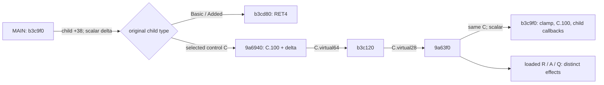

# MAIN child opacity callbacks and concrete dispatch

Follow-up **2026-11-02**: [Constructed receivers and MAIN call contexts](SFRAME_CONSTRUCTED_RECEIVERS_RE.md) qualifies selected control/auxiliary returns, sprite-array construction and key callbacks, and records the remaining-work priorities. It also reconciles the already-qualified ordinary resource-token translation; runtime selection/overrides remain conditional. The MAIN458 trigger and918630 receiver remain unresolved.

Verified **2026-11-02**, following the [interprocedural MAIN helper investigation](SFRAME_INTERPROCEDURAL_RE.md). **The actual receiver of `0x918630` and the nonzero trigger of `MAIN+0x458` remain unidentified.** This pass adds **four Native dossiers / 321 analyzed bytes / 99 instruction boundaries**, closing the selected child-opacity dispatch and identifying its loaded-object writes and bounds diagnostics. The original SFrame is not executed.

The target is original x86 SFrame SHA-256 `27f42fc8f6b08df8c239640b938d601aeaebb7b3db0c89fc47755325a98a410d`. REA **6.4.0**, Ghidra **12.1.4**, Capstone **5.0.7**, profile `b9d116ea480a02cc8773b19372074a3caf77785cbc080b1ac7133b5110e40b17` are retained. [Versions](VERSIONS.md) stay Core/RappelzRust **0.1.0 development**, NoLimits launcher **1.3.60**, SFrame file/product **9.1.0.0**, embedded **Source9.5.2**, network **201507080**. Exact official Epic/patch remains unconfirmed.

## Source-qualified child membership

The preceding pass established constructed MAIN's `virtual+0x28 → b36310 → b3c9f0`. The latter stores the clamped scalar at `M+0x100` and passes its change to each child through `virtual+0x38`. This pass follows that specific callback rather than repeating the whole `.text`, incoming-reference, PDB, or pointer-passage scans.

Existing Native sources qualify initialization and list membership: `8a1ab0 → 820f70 → b35b60` preserves MAIN; `b35d20` puts it at descriptor+0xb0. `b3ead0` creates a distinct control, applies the descriptor through that new object's virtual+8, reloads the owner at `b3eb80`, then passes the created control to `b3bd80` at `b3eb8b`. The owner list is `M+0x44`; retained `7438f0` stores the control into node+8, matching `b3c9f0`'s child-payload load at `b3ca35`. `b3c510` separately stores that owner at child+0x20. These are receiver/argument identities, not an inference from a shared offset.

The retained, fully parsed MAIN resource has **one genwnd root and 47 factory children**: static37, simplebutton2, gauge3, tab_sheet1, tab_head2, iconstatic2. The genwnd root is applied to existing MAIN, not counted as another factory child. Basic and Added resources retain their separate 141/72 child blocks. The three cached resource hashes and their earlier archive-transform proof references are reused; archive decoding is not claimed as new work.

Original registration `5b67a0/5b67a5` binds the `static` literal at d36180 to factory b67110. That retained factory allocates 0x2ec and installs exact KUIControlStatic vptr d8d0f0 at b6714e. The selected ordinary resource-token translation is already qualified by the caption/owner report. Registry success/selection, valid construction and stable vptr/list state remain conditions; complete grammar and live overrides are separate limits. The six named class tables below are source-qualified resource candidates, not an assertion that all their instances were observed running.

## The callback has two original targets

The previously measured **315 primary KUIWnd-family tables** are reused, with original words rechecked: virtual+0x38 selects **b3cd80 in 245 tables** and **9a6940 in 70**; virtual+0x64 selects **b3c120 in all 315**. This is a finite retained family, not a whole-program dynamic-target inventory.

| Constructed/resource candidate | Original vptr | virtual+0x38 | virtual+0x64 | virtual+0x28 |
|---|---|---|---|---|
| MAIN | d53af8 | b3cd80 | b3c120 | b36310 |
| Basic | d53448 | b3cd80 | b3c120 | b36310 |
| Added | d53be8 | b3cd80 | b3c120 | b36310 |
| static | d8d0f0 | 9a6940 | b3c120 | 9a63f0 |
| simplebutton | d664b0 | 9a6940 | b3c120 | 9a63f0 |
| iconstatic | d8d1d4 | 9a6940 | b3c120 | 9a63f0 |
| tab_head | d8deac | 9a6940 | b3c120 | 9a63f0 |
| tab_sheet | d8e074 | 9a6940 | b3c120 | 9a63f0 |
| gauge | d8b030 | 9a6940 | b3c120 | 9a63f0 |

Retained **b3cd80 is RET4**, Evidence `ev_80e068455a4edeba637bfb842c8341f539f145d282588234c5fe6d63caf6f6e7`. Thus explicitly inserted Basic/Added receivers stop this selected callback under intact original vptrs. Their descendant controls must not be counted as automatically traversed through this invocation.

For a selected control C, fresh **9a6940** reads `FLOAT[C+0x100]`, adds the passed delta, and dispatches the result through C.virtual+0x64. Retained **b3c120**, Evidence `ev_bb706ce5042d2e1947d55351150a6fa9bb0e2452ea871b92394db8dc2e9dd0a7`, forwards that float to the **same receiver's virtual+0x28**, selecting fresh **9a63f0** for the six resource candidates.

At 9a6952 and b3c12a, PUSH ECX is a placeholder overwritten by MOVSS[ESP] before dispatch. The actual physical argument is a float, not a whole-MAIN pointer. `C+0x100` is a scalar member; `+0x64` and `+0x28` above are vtable slots. None is the mode member `MAIN+0x458`.

Opacity is the semantic interpretation of the clamped scalar, relative updates and graphics-byte propagation. Original source names are not recovered; receiver identities, instruction widths and scalar operations are the observed facts.

## Concrete effects of 9a63f0

The helper preserves its entry receiver C in ESI. CALL b3c9f0 at **9a6403** receives the same C and the overwritten float stack argument. On normal completion, subsequent reads use the clamped value from C+0x100.

| Path | Exact receiving object | Qualified effect |
|---|---|---|
| CALL a8d710 at 9a6436 | R=[C+1f8]+i*0x144, under signed count C+1f4 | Retained helper writes R+141 byte=1, R+a8 float, R+cf converted byte |
| Nonnull branch at 9a6452 | A=[C+104] | 9a645a writes four scalar bytes at A+48 |
| CALL a8d710 at 9a6490 | R=[[C+1fc]+i*4], bounded by C+200 | Same retained loaded-receiver helper effects |
| Pointer vector C+208..C+20c | Q=[[C+208]+i*4] | 9a64d9 writes four scalar bytes at Q+10 |

The a8d710 body and its exact writes were captured in the preceding pass, Evidence `ev_317fe5bdb13d0ab727df18b3c7124217958b7a445d0ee75b377ceec58895b5b3`; they are reused. R, A and Q are loaded identities, not automatically MAIN or embedded MAIN subobjects.

The complete described 9a63f0 body accesses C-relative displacements **100,104,1f4,1f8,1fc,200,208,20c**. It does not read the owner field C+20. Its five direct callsites target b3c9f0, a8d710 twice, and the two error wrappers. There is no direct call to 918630 or 8fb010 in this body. This closes the selected explicit control/owner handoff; it does **not** prove absence of arbitrary R/A/Q-to-MAIN aliases, further descendant callbacks or runtime replacements.

The two fresh bounds wrappers **9a8f00 / 9a8f10** both push the exact original diagnostic `invalid vector<T> subscript` at dfd0ec and call bc85c1. The Ghidra body model ends each wrapper at that terminal call; 9a63f0 also has a terminal-call boundary on this error path. **Nonreturn is a provider FunctionManager flag, not independently proved runtime behavior.** The selected normal-return effects require live, consistent vectors and normal completion; exception/reentrant mutation is not silently summarized as a normal path.

## New evidence and verification

| Fresh Native entry | Analyzed bytes / instructions | Evidence ID |
|---|---:|---|
| 9a6940 | 31 / 10 | `ev_99dd4c6047ca68b8c2922b295283fc9116e04851d12250b0c0deb38989123ed3` |
| 9a63f0 | 270 / 85 | `ev_048dd5747da683bee2d0658a43d1c7888d1241532482d111653a0741868437aa` |
| 9a8f00 | 10 / 2 | `ev_6a7a89dcbfbd8944cfab3b743b22a2e018f1f320c9aca637cc6cbd5393acceb7` |
| 9a8f10 | 10 / 2 | `ev_8cff62426202226efeb25179c9876e1e257e63a98476940355fe9cd919e898f0` |

None of the four Native value-flow graphs reports truncation. Complete inclusive provider bodies and all **99 instruction boundaries** match original PE bytes independently. Terminal-call limitations remain separate from graph truncation.

Local ignored run: `client-data/audit/2026-11-02-sframe-child-dispatch-8b2d761a`. The frontier ledger verifies **13 reused Native sources**, nine named tables/27 selected slot words, **105 selected byte intervals**, the retained 315-table family and three cached resources. SHA-256: **`6cde6c6d26a36c8f02237ec845b9929f7036f85e0ea85a706f07914a39c2274b`**. The separate callback-effects ledger asserts **34 selected instructions / 35 byte intervals**, exact receiver contracts and error-path limitations. SHA-256: **`b2e66f5522cc03701a42efd774d4e2c935fd0ed2132e6b75ef0b933365e7a482`**. These interval counts overlap and are not advertised as distinct Native bodies.

One resource-limited owned REA/Ghidra session captures the four dossiers, checkpoints its new observations, imports the prior **699 canonical records unchanged**, exports **703 records**, and saves `sframe-child-dispatch.snapshot.json` before closing. The complete restart index has **561 Native functions across the central bundle and separately retained historical files**: 31 inherited index sources are outside that central bundle, and their file hashes, Native identities, provider bodies and original instruction boundaries are independently reverified. They are not new captures. The prior frozen 555-root model and 557-entry restart index remain intact. The snapshot is **329,823,896 bytes / 25 cached Native primitives**, SHA-256 **`2d591c7ecdc340a476e63a0e8f0236429b2c56567c92bccfd60dd7cb1f79c654`**. Canonical comparison parses the full bundle record by record to limit verification memory. No original executable process, server, client or database is restarted for this static work.

**Nine established data-preservation checks pass.** Eleven baseline file hashes, the installed WTF tree, logical database backup and existing service identities are unchanged. Only authored documentation is published through the isolated Core/Client worktrees. Gameplay/terrain code, installed assets/settings and package versions are preserved; raw Native dumps, original resources, backups and credentials stay local.

## Next identification requirement

The selected original child callback is now qualified as scalar-opacity propagation with distinct loaded-object effects. It supplies neither a reaching receiver for 918630 nor a source-qualified nonzero write to the same constructed MAIN's mode byte. The original investigation remains open.

Continue from an actual MAIN-bound nonzero writer, a reaching entry/registration for 918630, or a concrete new loaded-object/owner alias. The other control-family virtual+0x28 overrides are not automatically MAIN resource members. The earlier interprocedural rejection journal also omits callsite bindings before some eligibility checks; recording those identities before rejection would improve future prioritization without raising quotas or accepting unsafe summaries. Do not repeat the closed selected-child dispatch, old PDB/incoming/whole-text scans, or treat bounded negative results as global unreachability.
