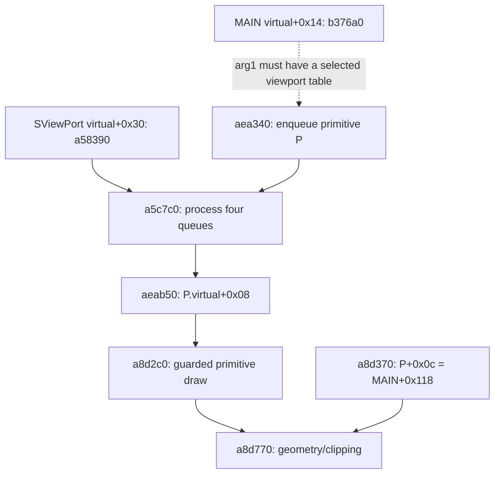

# SFrame MAIN retained-pointer consumer and rendering dispatch

Verified **2026-11-02** on original x86 SFrame SHA-256 **`27f42fc8f6b08df8c239640b938d601aeaebb7b3db0c89fc47755325a98a410d`**, using **REA 6.4.0 / Ghidra 12.1.4 / Capstone 5.0.7**. This continues [MAIN mode readers and retained rendering aliases](SFRAME_MAIN_MODE_READERS_RE.md). **The retained MAIN+0x118 pointer has a typed geometry/clipping consumer: KSpritePrimitive virtual+0x08 selects a8d2c0, whose guarded a8d770 call reads only the four rectangle coordinates. A compatible viewport enqueue/queue/primitive-dispatch route is identified, conditional on the unbound rendering-context argument. The actual context passed to MAIN, the receiver of 918630 and the alternate-mode trigger remain unresolved.** New evidence comprises **17 Native dossiers / 4,459 analyzed bytes**. Reused bodies and raw source-byte checks are distinguished from new Native analysis. No original-client execution is claimed.

[Versions](VERSIONS.md) remain Core/RappelzRust **0.1.0 development**, NoLimits launcher **1.3.60**, SFrame PE file/product **9.1.0.0**, embedded **Source9.5.2** lineage and network literal/profile **201507080**. Exact official Epic/patch remains unconfirmed.

## From constructed MAIN to a rendering consumer

MAIN retains the address MAIN+0x118 in a separate primitive through the previously qualified a8d370 setter. The selected original MAIN rendering method b376a0 calls virtual+0x28 of its first physical argument at b376d3, b37707 and b3776f, passing a primitive pointer and flag0. The reaching definition of that argument remains unbound. Direct callers 747170, 747300 and 747310 only forward their own first argument; they do not construct or identify it. The concrete viewport path below therefore remains conditional on that actual argument being a live object with the selected original table.

Original RTTI tables KViewportObject, SViewPort, SGameViewPort, SShadowViewPort and SWaterViewPort select aea340 at virtual+0x28. Its actual body enqueues the primitive pointer into context+0x580/+0x590 for a nonzero flag, or context+0x5a0/+0x5b0 for flag0, selected by primitive byte+0x140. The MAIN handoff uses flag0. aeac40 copies the pointer value into the vector and advances its end by four bytes; growth copies pointer storage. It does not copy MAIN or the primitive object. aea340 also computes primitive+0xa0 from primitive+0x48 and queue count.

The original SViewPort virtual+0x30 entry a58390 calls a5c7c0 at a587d3. That helper processes the four matching vectors in order +0x5a0, +0x5b0, +0x580 and +0x590 and calls aeab50 with their begin pointer and count. After an unanalyzed ae8df0 range helper, aeab50 loads each P and actually calls P.virtual+0x08 at aeab86 with physical arguments (viewport, [viewport+0x3e4], 1). For the separately constructed MAIN+0x3d8 primitive whose original d7f910 table survives, this target is a8d2c0. Its guarded call to a8d770 consumes the saved rectangle pointer P+0x0c for geometry/clipping. The viewport receiver remains conditional; the queued-primitive dispatch itself is supported by actual loads and calls.

The connection for a particular queued pointer requires valid container bounds, successful allocation, original tables, live objects and saved-pointer lifetime, ordinary callee-saved registers, and ae8df0 preserving the element set before dispatch. The range helper and callbacks may have side effects or reenter; they are not declared pure. a5c7c0 processes the vectors; a separate optional virtual+0x38 path clears their end pointers through ae9bc0. Clearing is not primitive deletion or ownership proof. Other viewport overrides and the unbound MAIN argument prevent an unconditional frame-wide trace. Complete original source-body checks are distinct from bounded Native pcode metadata.

The dotted entry is the unresolved MAIN rendering-context binding. Queue storage, range-helper conservation, surviving tables and object lifetimes remain conditions of the selected route.

## The pointer retained by KSpritePrimitive

On the selected successful allocation/construction path, the authenticated KSpritePrimitive object P occupies storage distinct from MAIN, conditional on valid allocation and lifetimes. Constructor a8cfd0 clears P+0xc; setter a8d370 stores its one pointer argument there and marks P+0x141 dirty. Actual MAIN virtual +0x24 (b363f0) supplies MAIN+0x118 to selected 0x144-byte primitives; b37fe0 supplies the same pointer on its initialized second-array path.

The exact primitive table has three primary slots: +0=9a4940, +4=a83bd0, +8=a8d2c0. The next DWORD is a separate class COL, not a fourth primitive slot. Slot+8 calls a8d770 when P+0x141 and P+0x142 are nonzero. The saved pointer is a clipping-rectangle input: a8d770 reads four signed DWORDs at offsets 0, 4, 8 and 12, rejects disjoint bounds or adjusts clipped geometry/UVs, and constructs four 28-byte vertex records on P.

In the selected clipping helper, the S-relative interval is exactly S..S+15 and there is no store through S. With S=MAIN+0x118, these are MAIN+0x118..0x127, whereas MAIN+0x458 is S+0x340. Instruction writes target stack locals, primitive vertex fields P+0xd0..0x13f, primitive P+0x143, and four global DWORDs at 0xedb744, 0xedb748, 0xedb74c and 0xedb750. Each global receives a 4-byte MOVSS transform coefficient computed from primitive float fields and matrix C+0x68; none captures S or P as a pointer. The four direct resource helpers are verified 4-byte getters with no stores or outgoing calls.

This is static selected-route evidence, not observed execution or a complete callback-effect closure. The outer render callback has other state/device and indirect graphics calls. Registration, deletion, allocator/lifetime aliases, resource/device mutation, reentrance, interference on mutable shared globals, corrupted pointers, arbitrary subclasses and unrelated methods remain bounded unknowns. Dirty byte P+0x141 is not MAIN mode byte +0x458.

## Alternate-mode activation

This closes a concrete conditional rendering consumer of the saved MAIN+0x118 rectangle pointer. It does not establish the actual renderer passed to MAIN in a live session, a nonzero write to MAIN+0x458, or the caller/receiver of918630. No alternate-mode activation is claimed.

This closes one concrete MAIN interior-pointer consumer as geometry clipping under the observed intact-object conditions. It establishes neither a nonzero MAIN+0x458 write nor the identity or entry trigger of 0x918630. No old global scan or caller query is repeated.

Retained 918630 still saves an unbound entry ECX in EDI and reaches 8fb010 at 918726, projecting byte outer+0x458=1 and DWORD outer+0x45c=0. No new reaching definition identifies that outer receiver as constructed MAIN. MAIN's byte+0x458 lies 0x340 bytes beyond S=MAIN+0x118; the selected clipping helper reads S+0..0xf and does not store through S. This closes the specific rectangle-consumer hypothesis under intact-object conditions, not all indirect/callback/alias effects. Existing mode-reader, pointer-scan, incoming-reference, PDB and rectangle-vector producer results are reused; no original runtime activation is observed or reconstructed.

## Evidence and verification

All records bind the target SHA-256 above and analysis profile **`b9d116ea480a02cc8773b19372074a3caf77785cbc080b1ac7133b5110e40b17`**. New graph truncation: none. Reused graph truncation: none. Complete body bytes and retained records do not imply complete high-pcode graphs or whole-program effects.

| New Native entry | Analyzed bytes | Evidence ID |
|---|---:|---|
| 0xb3cfd0 | 49 | `ev_92f6b6976a4d91f0e764268ade2d2a4f627940148d42a2def4715098ba36a362` |
| 0x747170 | 385 | `ev_35d1fe9401d4f64cb5ca01db025579aaf13f861ef1f8ad5579c965bb4004b933` |
| 0x747300 | 9 | `ev_8ac832b4ff686c4bc48a0fe6487dec660d2ea8e07bfc28fd870f97dd9188e550` |
| 0x747310 | 9 | `ev_8a7b8a0d3dc98427f99bcf2b43cd9bb41a7cbc52a52d6a0cfd57bd7e014761f3` |
| 0xa8d2c0 | 169 | `ev_c4108fd0eae76c876fa25316b304434af7049ea6b1fa805380f568927a3b341d` |
| 0xa8d770 | 1674 | `ev_3dabbf8eef2310246396eb0dd4a1d3bd95dc19af575938a91e19f26fa586097f` |
| 0xa83bd0 | 3 | `ev_9a8a6b5c51d792b8ec71426f3f036d6052f96456793c77795963c07e14667d81` |
| 0xa8d150 | 103 | `ev_fd40704ce74ead88ee76c9413a6029e09edcc7aecb02b8a4bc11657670e98913` |
| 0xab64d0 | 4 | `ev_21e28c73252ab58ee60e1e417b0555976fb898b58233241444e518cd5b6af16a` |
| 0xab6590 | 4 | `ev_b9eeab73ea4e04eddcdd4c5c0dd6d36ae6710025cc42d951c9401549ed9482e3` |
| 0xab6410 | 4 | `ev_17a44904af07384e30a5b9a20bd66bdfa440f45e886c639740e796fa4d6a5cb2` |
| 0xab6420 | 4 | `ev_4621519bb7ca6585e47b260fad0fd15d16ca5fbcf3318dd90cf1d245cc9b5504` |
| 0xaea340 | 114 | `ev_554d8a9d214da9115ca6456a5dcb3c5f8df255f6f9a676c7e8e753bbddb17079` |
| 0xaeac40 | 145 | `ev_b22ab66bc6163e0731e4c2bf83ab59c20bf63006ec85e733450a7ccb430b192b` |
| 0xa58390 | 1246 | `ev_d4fc5ce6f0c609a794431d3209067b19771e0ea68333b1662e7be94ac5ff2cc1` |
| 0xa5c7c0 | 468 | `ev_6f1a2f7ca0c2443acf19e9db4cbbf7e2d1666267dfa627e917127f5a4aa74921` |
| 0xaeab50 | 69 | `ev_5a9079aba7c6c1642b5b5e61e7022336add70c6309ff8573fb1651790edd00c1` |

| Selected reused Native entry | Evidence ID |
|---|---|
| 0x8a19f0 | `ev_f3a4ff37e3949c13ed452102ee534729623efb381bd564fe0da8330bbded3cd2` |
| 0x9a4940 | `ev_93d09db6a3a5833fa364cfdd96ad74b88bfa535f00c5d22579169860a3f725e0` |
| 0xa8cfd0 | `ev_3b64e6e3f9bf7cf46f971bc223ef48c6d68de12071c462fa9d6cefd7d1dbf49d` |
| 0xa8d370 | `ev_83932bb15621cc2b6979b3e7970d570883e86589796b140d84e329518b8259e3` |
| 0xb35d90 | `ev_5cb2886f4bc408c96a914bdfa775c377c41a9598aa01e14a748d9e0a310be6e9` |
| 0xb363f0 | `ev_6f4e0a17cd43ad32da91d644e421a212ea02a4a1427e10dde52f78c9aa6752a9` |
| 0xb376a0 | `ev_10d7bfd5420317fd7d23d357bf1455a5e746ddac4cb283d31e4b96f022822561` |
| 0xb37fe0 | `ev_c228333fa818dfff157c8c2383793f5c30d892dcf55b5a090165a2cf990c9ff1` |
| 0xb38220 | `ev_7a4a0a55c1c4240240d3ff1e6842ef4c2f77c8d3ef65cf6d24281f4d72bb507b` |

Independent checks bind all new Native bodies to original file bytes, verify **1,164 new assembly boundaries**, **315 selected provenance intervals**, and **12 reused Native bodies**. Both rendering and primitive ledgers preserve source-file hashes, original-byte provenance, selected ABI paths and their limits. Overlapping checks corroborate the same static artifact.

The owned Native session checkpoints **17 new observations** and imports the preceding **646-record** canonical bundle. All preceding records remain equivalent as JSON values. The final canonical bundle holds **663 records / 295,749,909 bytes**. The saved snapshot holds **38 cached primitives / 310,421,308 bytes**, SHA-256 **`c69801a70bcf39907e66a64afe6354c8527ab208668becacedcd6dba9d471d95`**. Older Native records outside this subset remain in the historical source index. The provider close completed successfully and wrote the snapshot below.

Ignored local run: `client-data/audit/2026-11-02-sframe-main-render-consumer-9d2c8f64`. Full records, both ledgers, selected byte checks, checkpoint, snapshot and preservation/publication receipts remain local.

**Nine preservation checks pass.** Eleven baseline executable, addon and settings hashes, the saved-variable tree, logical database backup and primary service identities remain unchanged. The root Git index stays empty. Only seven authored Markdown files are synchronized through isolated Core/Client worktrees. Gameplay code and versions are unchanged; original assets, binaries, databases, credentials, settings and generated decompiler output are not published.

## Restart point

Reuse this run's snapshot, rendering/primitive ledgers and historical Native index. The clipping consumer and compatible queue dispatch are closed for the selected contracts; do not repeat them as unknown or expand the primitive table beyond its three slots. Continue only from a demonstrated reaching definition for the argument delivered to MAIN's virtual+0x14, another concrete saved-pointer consumer, or a typed MAIN pointer reaching a nonzero mode write. Preserve the queue allocation/sort, dynamic-table, lifetime, shared-global and indirect-device boundaries. The 6,720-byte local manager-neighborhood probe is explicitly heuristic and partially decoded; it is not whole-class or whole-program coverage. No matching offsets, compatible signatures, absent original PDB or synthetic call establishes 918630's receiver or activation event.
