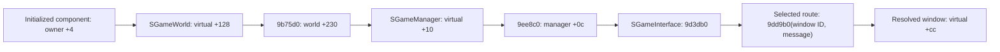

# SFrame target-info activation and concrete message recipients

Verified **2026-11-01** on original x86 SFrame SHA-256 `27f42fc8f6b08df8c239640b938d601aeaebb7b3db0c89fc47755325a98a410d`. **REA 6.4.0 / Ghidra 12.1.4** retained **36 new function dossiers / 76,127 analyzed body bytes**, plus four focused reference/string queries. This continues [the dispatch investigation](SFRAME_DISPATCH_RE.md). No original client was executed; these are static observations and decompiler output, not original source or a gameplay trace.

Two concrete results replace earlier unknowns: the target-information window has an explicit button/message activation path, and the component-to-interface forwarding chain has construction and RTTI provenance. **The nonzero setter of the main character window's byte +0x458 is still unidentified.** The separate target window must not be presented as that setter.

Versions stay explicit in [VERSIONS.md](VERSIONS.md): RappelzRust/Core **0.1.0 development**; NoLimits launcher **1.3.60**, original SFrame PE metadata **9.1.0.0**, embedded build lineage **Source9.5.2**, network literal/profile **201507080**. Exact official Epic/patch remains unconfirmed.

## The target-information button opens a separate window

The original button-name table at **0xe9387c** has eleven entries. Index **6** points to **0xd34208**, the literal `target_info_button`. Original RTTI binds event method **0x00722720** to `SUITargetWndAddon` through vtable **0xd34368**, slot **+0x18**. On event **10**, that method compares button names and calls **0x007212d0(index)** for the matching entry; it subsequently requests that the current addon window close.

For **action 6**, 0x007212d0 reads the selected handle from **[this+0x424]+0x208** and returns if it is zero. It constructs and posts these two **internal** messages in this order through **0x009eeb40**:

| Internal kind | Target / content | Observed request |
|---|---|---|
| 0x426, `SIMSG_UI_SEND_DATA` | window ID **0x5d** at +0x13; `target_info_open` string at +0x17; selected handle at +0x47 | Supply the target to the window. |
| 0x3f9, `SIMSG_SHOW_UIWINDOW` | window ID **0x5d**; state **1** at +0x17 | Request that this window be shown. |

The offsets above belong to internal objects. They are not wire layouts or newly recovered server opcodes. Producer order is statically established; runtime delivery, allocation failures and complete lifetime semantics are separate questions.

Window creation **0x009cb4e0** allocates **0x454 bytes**, calls **0x009c00e0** and registers ID **0x5d** through **0x009c8920**. RTTI names it **`SUIFulldownTargetPlayerWnd`**, vtable **0xd6cc88**; its resource is `window_target_player_character_info.nui`. This differs from main window **0x2e**, `SUICharacterInfoWnd`, vtable **0xd53af8**, allocation **0x478**, resource `window_player_character_info_main.nui`.

An exact original-byte switch check maps internal kind **0x426** in **0x009d3db0** to **0x009da7fd**. That block passes **message+0x13** as window ID and the same message to **0x009dd9b0**, then marks it handled. The helper looks up the ID through **0x009e4330** and invokes the returned window's virtual **+0xcc**. For constructed ID 0x5d that slot is **0x007c1f00**; it recognizes `target_info_open`, copies message+0x47 into **its own +0x450**, refreshes through **0x007c2070** and marks the message handled. This is a concrete sender-to-window path, subject to successful construction/lookup and the enclosing interface handler's guards.

The target refresh accepts the stored handle or the selected-handle fallback only when it matches the current selection. It requires the actor and actor-data pointers. It displays name, level, HP/MP maxima and selected combat attributes. If selected actor fields satisfy the inspected zero checks, it can read a cached **122-byte internal stat message** by handle through **0x006c8040**. This does not establish server disclosure permissions or a new request/reply protocol. The close event method **0x007c1fe0** posts kind 0x3f9, ID 0x5d, state 0.

## The original +0x458 question remains bounded

The earlier constructor/visibility resets and mode readers of `SUICharacterInfoWnd` remain valid. This pass expands beyond its method region with an isolated Capstone scan of **9,589,018 executable-section bytes**. The sequential decoder includes skip-data records; it is not a recovered whole-program control-flow graph.

The retained inventory contains **521 literal-displacement write candidates** overlapping +0x458 or +0x45c, including **145 nonzero/unknown mode candidates**, **32 local affine-alias writes**, and **244 LEA address candidates**. The alias analysis resets at calls/branches and does not resolve arbitrary interprocedural pointer flow. A secondary alignment scan retains interior-byte candidates separately rather than treating them as confirmed instructions.

All **six direct BYTE nonzero/register candidates** have other receiver-class provenance: auction tender, chatting options or raid-siege rotation windows. Four prioritized writes in the window-construction region belong to store, quest, creature or chatting-option classes. The nearby +0x454 alias writes at 0x8a4a57/0x8a4cc7 belong to `SUITitleWnd`. No typed nonzero main-window mode assignment is established. Wider/SSE candidate ownership, generic copies, aliases across calls and external runtime writes are not globally resolved; **do not infer that the mode is impossible, removed or always zero**. Numeric message kind 0x458 and stack variable `local_458` are also unrelated to this field.

## A concrete component-to-interface forwarding chain

Initialization **0x006c8220** supplies its context's **+0xa4** owner to **0x006e1340**. The latter writes that owner to **+4 of 17 components** in `SGameUIInstance`. The inspected world-construction path **0x00a3b7b0 →0x006c4310** supplied the `SGameWorld` instance to that context.

This closes the previously unresolved receiver of the shared helper **0x006e12e0** for that initialized path:

RTTI and original slot bytes independently give **SGameWorld.d78708+0x128 →0x009b75d0** and **SGameManager.d70c0c+0x10 →0x009ee8c0**. The latter tail wrapper explicitly loads **ECX=[ECX+0x0c]** before jumping to 0x009d3db0; pseudocode alone omits that receiver adjustment. Application initialization **0x00a69ed0** constructs `SGameInterface` via 0x009bedc0 and passes it to the manager constructor 0x009ed620, which stores it at+0x0c. Initial-game creation and the inspected transition through 0x009e7970/0x009e8ba0 preserve the same manager in the game world's inherited+0x230 field.

The nearby ctor 0x006e0d70 creates `SRaidMgr` at a different object's+4. Its six-entry vtable cannot supply a+0x128 slot. That proximity was a false lead; actual owner assignment and callers are required. This construction proof does not assert that every use of the shared forwarder, every active runtime component or every message follows this route.

For STAT_INFO's internal kind **0x1f**, an independent switch check selects 0x009d5e87. The inspected block has actor/flag predicates before calls delivering to main character window 0x2e and other IDs. The predicates and the interface's earlier callback/guard paths prevent a blanket unconditional-delivery claim. The prior local-vector/deque order is not an original server emission-order guarantee.

## The callback prepass has an identified subscriber

Main-context initialization 0x006c8220 allocates a **32-byte registry** through 0x0071a930 and stores it at context+0x120, the exact field read by 0x006d2e60. It also constructs the named contents **`huntaholic`** through 0x0071c6a0 when the inspected lookup is absent. Original RTTI binds that object to **`SHuntaHolicSystem`**.

Its constructor registers these eight internal kinds via 0x0071cfd0:

| Internal kind (decimal) | Stored handler entry | Stored this adjustment |
|---|---|---:|
| 0x7e (126) | 0x71d890 | 0 |
| 0x7f (127) | 0x71d830 | 0 |
| 0x80 (128) | 0x71d690 | 0 |
| 0x81 (129) | 0x71de10 | 0 |
| 0x82 (130) | 0x71d3b0 | 0 |
| 0x4a (74) | 0x71d5c0 | 0 |
| 0x4 (4) | 0x71dab0 | 0 |
| 0x83 (131) | 0x71d9b0 | 0 |

Native assembly in 0x0071cfd0 loads the registry from contents+0x1c before 0x0071be40. That insertion appends the **contents instance** to the same kind-keyed vector later read by 0x0071adf0. The existing 0x0071ade9 thunk invokes primary virtual+0x0c; **SHuntaHolicSystem.d340e8+0x0c →0x0071d350**. Its dispatcher finds message+4 in contents+0x24, applies the stored this adjustment and invokes the stored handler. The eight handler addresses above are registration targets, not eight separately decompiled bodies in this pass.

There is **no 0x1f/31 registration in this complete constructor list**. This narrows the earlier optional-prehook uncertainty, but does not prove the entire runtime registry lacks other subscribers or later mutations. It does not establish that all UI updates occur after stat-bank writes. The global server sequencing and bonus formulas remain unresolved.

## Retained Evidence, recovery and preservation

| New function entry | Analyzed bytes | Role | Evidence ID |
|---|---:|---|---|
| 0x6e3640 | 944 | Inventory message producer sample | `ev_87b8dff0a796362541ff12caf6fa5ee671d251441a1ad422cae5bd3de1029a0f` |
| 0x6f22a0 | 1,041 | Guild-icon producer sample | `ev_c0c8ccb78edef89dab5fb04d49cb3a3ff72b88b24a51b0a2a4115f100b15f2c2` |
| 0x9cb4e0 | 21,038 | Window creation and registration caller | `ev_4275b7d64861bda9d3f1369468c58deec344a973e3c6e12679479663f89ad441` |
| 0x9d3db0 | 36,568 | SGameInterface main message handler | `ev_83e67f6199a1a76051df09eebc8044ed8a07305f6d8d4781f3f2f0314abbfc2f` |
| 0x9c8920 | 677 | Window loading/registration | `ev_4a5435ee59e170130751d04fb39f47a481fa7b5c82322bcd854db8e838d4e2cc` |
| 0x9e2aa0 | 1,012 | Window registry insertion | `ev_8517cbb679aeec97719d6893e9c703edabbd32bf7ff31ca240d710d42bb50bcc` |
| 0x6e0d70 | 867 | SGameUIInstance construction: counterexample | `ev_008f298b31f74565d16d044efd8e8ca14290b5317801c02b5b28fba078017242` |
| 0x6f0980 | 219 | SRaidMgr construction: counterexample | `ev_339f7ae5fef8ed7cce993dc82a09f79f89dd3c07d63e80c568db04482b439308` |
| 0x71a930 | 145 | Callback registry construction | `ev_e63f826f6b65966335ff1298e88708340d97a96bc39f0500131e821f807d761c` |
| 0x6c8220 | 521 | Main context initialization | `ev_71675c853debf148612eaadfea8dfd388d7ae5979eb03195dd7d982a44dd6088` |
| 0x71c6a0 | 653 | SHuntaHolicSystem construction | `ev_22c04e2ec5a115c20aa69950c21fe0f0ecad8283c4a7c23cfa53a54a65f5fe3e` |
| 0x71cfd0 | 144 | Callback registration wrapper | `ev_f8c0eba6b24e05895308c04c3608552547de6de2b90f7885d1ca1afb0acf9b7c` |
| 0x71be40 | 261 | Registry list insertion | `ev_53092f695877d9a950b39c116567c8c87098a7d80763e7e4535c78eae9a9d9c3` |
| 0x71d350 | 85 | SHuntaHolicSystem virtual callback | `ev_18bdc58702c4242e594eea441e8726d459886d816cc3f68e77259c55b204e51d` |
| 0x6e1340 | 34 | 17-component receiver initialization | `ev_6a814580825d8075afd8f08b2fbe79d860209db999454dcafc968e202f7e1df3` |
| 0x6c4310 | 754 | Main context construction | `ev_df69fedf629870844905127b3500cc7f335f184565a4459d4fe21c271db59121` |
| 0xa3b7b0 | 1,616 | SGameWorld initialization | `ev_25139c79f85ef80ee96e9a4de4f4849082c61d73d3df6d5b933feabded10f843` |
| 0xa359b0 | 1,054 | SGameWorld construction | `ev_cadd245417a65338362e62ac36fd6deaddd215958b8dd3441325d8faecea964c` |
| 0x9b75d0 | 23 | World-to-manager forwarding | `ev_5f908be21c2a229681371210103a617efda3b89b73dc9d21f94a396c33e01130` |
| 0x9c00e0 | 62 | Separate target-window construction | `ev_41dc2466e81ecb4ec03a39cec6da93517351daf3304a9e7f0d35e0c13983e533` |
| 0x9dd9b0 | 32 | Window delivery helper | `ev_0574d2fb38e2b73df2742d3b8962198eef271497c7cdfe3897846e84f6655b23` |
| 0x9e4330 | 241 | Window ID lookup / lazy creation | `ev_9d7dc073b11c44636f3419900ec9739205ea7ec609bdc7d5ad6edc9e00bdbbb2` |
| 0x9ee8c0 | 12 | Manager-to-interface tail wrapper | `ev_f6401cb43b6dc2b1cea75674e56b68e3f3aedff971e8059551991d0fcd16b494` |
| 0x9ed620 | 707 | SGameManager construction | `ev_ecbb5cfdb6e09384fdc6748777d17c2475a307dd7b0cb669b61912e7bc9cf012` |
| 0x9e6a20 | 489 | SGame base construction | `ev_edd1030f2ae08296b29d36dd24cbc0e002adcffcb39c9b21a5124f6a3d389af7` |
| 0x9ee5e0 | 176 | Initial game creation | `ev_353c71c6824afa58e5dbb64cb5910632fbf88b8866a9dcf211a52dbf5c3d0858` |
| 0x9e7970 | 487 | Manager-preserving game transition | `ev_2fd9d43230a366f0b772dfec809e7a2d0c32cfd3acc571a5f500dea613c56592` |
| 0x9e8ba0 | 342 | World construction during transition | `ev_d1e1d62daafb5dbe42219ede920160e99b48dc1453dfbf0d308b9726c49928b9` |
| 0x9bedc0 | 1,363 | SGameInterface construction | `ev_b705a3a4675c9c800473191bafa27ef01bf809be1ed93ecaf380812277799d31` |
| 0xa69ed0 | 339 | Application interface/manager construction | `ev_e1cd440ad8e2b62240e0459982853a329e83a353a8045646d0e2af461b95c55d` |
| 0x7c1fe0 | 142 | Target-info close button | `ev_7207f3035b91a7c4832d45629cadc2bafa8b23ddf81a87e4e7acf96e71593bb2` |
| 0x7c1f00 | 155 | Target-info message receiver | `ev_cd776f58ea53fdeff195da257b8c92884ac85913282e735ddf06b98ff52cc02f` |
| 0x7c2070 | 973 | Target-info rendering / cache fallback | `ev_47539de1133d99b3155bf35fb6a70cbfd260da9c7944f263a8f12e039d777bc7` |
| 0x7212d0 | 2,653 | Target context actions / info producer | `ev_599dcd251cb4d5b82f08970aa8a8fc2f9e2985aa016ba37bf74026a5383e678f` |
| 0x6c8040 | 79 | Handle-keyed cached snapshot lookup | `ev_170d67b993744998f78a232df0804db51fc5140c1bbbae349c2e33babb1b6eed` |
| 0x722720 | 219 | Target context button-name dispatch | `ev_41599d2743bea24da123d3ffef177e9c2ed62f16c9cc7cf2d4087f701e2b3f5e` |

All new records match the original SHA and profile digest `b9d116ea480a02cc8773b19372074a3caf77785cbc080b1ac7133b5110e40b17`. The matching previous snapshot imported ten earlier records; they are reused, not counted among the 36 new function analyses. The four other fresh operations are a vtable xref (`ev_3bedb3a360fa07876c2cdfe446e505525b5c3265fee1d6f27487dd104ee65d76`), a bounded string search (`ev_12eaf750b0851ce97e10eff3ebb5dacc148911119419ba37fd220051572df53e`), the target-info literal xrefs (`ev_fa6d984167b26d9fe662a9ef5dc1607fc9cde3c1308cfcdaf8243c864b75eb90`) and provider resolution of the producer's containing function (`ev_f07faccd33622761769bd5b8deaca3486159b2dcc54d7bef2591edc2e8f6c27d`).

The first query completed in **397.59 seconds**, including default Ghidra initialization. The two large dossiers 0x009cb4e0/0x009d3db0 exceeded the stdio response budget. Both completed records were recovered by exact retained Evidence ID from canonical exports **without rerunning either producer**, then the same session continued. Their native value-flow graphs remain truncated: **0 and 240 known omitted edges**, respectively, each with omitted-operation lower bound 1. The other 34 new graphs report untruncated. The large handler also reports unsettled type propagation; selected switch bytes, argument setup and receiver adjustments were checked separately.

The final **43,893,994-byte Evidence bundle** contains **50 records**: ten imported and 40 new observations. Closing the owned session succeeded; its **87,701,707-byte snapshot** retains 46 primitive entries and 50 Evidence records. Raw exports, private decoding dependencies and ledgers remain ignored under `client-data/audit/2026-11-01-sframe-mode-recipients-be35825e/`.

The byte verifier checks **5,528 distinct original byte-range records**, including the recipient ledger's **49 selected intervals / 11 RTTI classes**, original button tables, switch selectors and receiver-slot bytes. These overlapping checks are corroboration, not 5,528 independently reconstructed functions. All **nine original data-preservation checks** pass; original/installed executable, addon and WTF hashes and primary service identities match the baseline. Only documentation is published. No Rust gameplay, schema, asset, installed binary, original database or package-version change is made; historical runtime/test counts are not rerun results for this pass.

## Restart point

The selected target-info button/producer/receiver path and the inspected owner-to-interface construction chain are answered statically. Known callback registration and final-window routing are partially answered: runtime subscribers, all interface prehooks and complete fanout remain outside the evidence. **Main-window nonzero +0x458 activation remains unresolved** despite the broader bounded scan. Follow concrete generic property/copy callers or controlled original runtime evidence if available; do not map the target-info window's+0x450 onto main-window+0x458 or invent server permission/stat-generation rules.

## Follow-up: named predicates, prehooks and world order, 2026-11-01

[SFRAME_STAT_ROUTING_RE.md](SFRAME_STAT_ROUTING_RE.md) identifies the previously unnamed context getters and the own-player/creature-slot predicates, distinguishes the weaker storage helper, and binds the pump’s load/world receivers to their actual virtual slots. The selected normal world route processes core stats before interface delivery and sets handled before forwarding; load, secondary-context and display-prehook kind 31 return branches are verified. These facts narrow the earlier predicate/order uncertainty without proving complete UI fanout or runtime/server policy. Extended alias tracking adds seven unrelated stores but still does not identify main CharacterInfo+0x458 activation. Original files, installed data/settings, services and versions remain preserved.
