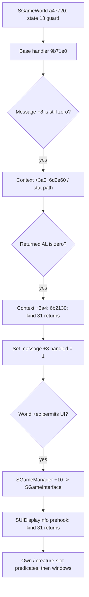

# SFrame STAT_INFO routing guards, call order and mode aliases

Verified **2026-11-01** on original x86 SFrame SHA-256 `27f42fc8f6b08df8c239640b938d601aeaebb7b3db0c89fc47755325a98a410d`. **REA 6.4.0 / Ghidra 12.1.4** retained **27 new function dossiers / 21,720 analyzed body bytes**. This continues [the concrete-recipient investigation](SFRAME_MODE_RECIPIENTS_RE.md). No original executable ran. These are static paths and recovered pseudocode, not original source or a gameplay trace.

The previously unnamed UI predicates are now tied to **SPlayerInfoMgr** and **SCreatureSlotMgr**. The guarded normal world route calls the stat handler before interface distribution, and sets the message handled byte before forwarding to that interface. **The main character window's nonzero +0x458 activation is still unresolved**; the broader alias investigation has excluded additional unrelated writes.

[Versions](VERSIONS.md) remain RappelzRust/Core **0.1.0 development**, NoLimits launcher **1.3.60**, original SFrame PE **9.1.0.0**, embedded build lineage **Source9.5.2**, network literal **201507080**. The exact official Epic/patch remains unconfirmed.

## Concrete predicates before UI stat delivery

The original kind 0x1f branch in SGameInterface/0x009d3db0 uses two short getters. **0x007879f0** returns **SUIDisplayInfo+0x258**; **0x00781260** returns **+0x260**. They are not actor lookup functions and consume no stack argument. Native argument setup pushes the message handle before the getter; that argument remains for the subsequent predicate call. Pseudocode alone obscures this convention. The player-context getter must first be nonnull for this branch to continue. All offsets here describe internal messages/objects, not new wire layouts.

RTTI and constructor bytes identify +0x258 as the complete **SPlayerInfoMgr**: UIInstance stores its secondary SGameUIMgr subobject with **+0x1f8**, and SUIDisplayInfo subtracts **0x1f8** when retaining it. Its +0x260 comes from the UIInstance entry constructed as **SCreatureSlotMgr**.

| Predicate | Exact inspected condition | Selected downstream UI route |
|---|---|---|
| **0x00722470** | Argument handle is nonzero and equals **SPlayerInfoMgr+0x204**. | Main character window **0x2e**, then window **0x0b**. |
| **0x00710ab0** | Find the first matching handle in the creature manager's vector **[+0x3c,+0x40)**. The selected element must have a nonzero +4 field; its data+0x13 must be nonzero and equal one of **six dwords at manager+0x1c..+0x30**. | Windows **0x31**, then **0x32**. |

For the second predicate an element whose +4 is zero contributes candidate handle 0; otherwise the candidate is data+0x17. The first handle match is checked, so this is not a generic existential search over every valid duplicate row. The six individual field names and gameplay slot subtypes are not established by the RTTI name. **0x00710200**, called during construction, clears these six fields and the surrounding reset area and cleans the vector; no original reset was executed in this audit.

The earlier storage helper **0x006d2b70** calls a different predicate, **0x00710be0**. That helper only tests candidate-handle existence in the same vector; it does not require the six-field membership check. It reports its boolean in **AL**, with other EAX bits not normalized. An invalid element can contribute candidate0, so a zero argument has a distinct edge case in this helper alone. Do not equate the storage predicate with the UI predicate or infer end-to-end acceptance of a malformed packet from this isolated edge.

The two window-state helpers also differ: **0x009d1340** uses 0x009e4330, whose earlier dossier includes lazy creation, then reads the window byte+0x0c. **0x009d1280** checks the registered-window lookup 0x009e50b0 before reading that byte. Their presence elsewhere in the dispatcher does not add a visibility condition to the inspected own-handle predicate above.

## Pump receivers and guarded normal world order

The processing object of 0x009ef310 is SGameManager on the established construction path. Its **+0x24** root is constructed as **SGameLoad**, whose valid virtual+0x1cc is **0x009e7fe0**. The separate resolver **0x009ee690** scans manager's game vector and returns the first game whose **+0x228** matches manager+0x14, or null. For a resolved **SGameWorld**, virtual+0x1cc is **0x00a47720**. **SGameInterface has only three confirmed primary virtual slots; it has no valid +0x1cc slot.**

In the inspected deque pump block, a nonnull root receives its virtual+0x1cc call before the resolved game receives its own. There is no handled-byte read between those two calls. The local-vector path instead targets only the resolved game, then calls the message's first virtual slot. These are different delivery structures; receiver sources may alias in other states.

For internal kind **0x1f/31** the constructed SGameLoad handler returns at its initial kind inequality. The normal SGameWorld path is:

The first diagram node includes early guards; the handled-byte guard is tested after the base helper. Original bytes at **0xa477c7/0xa477ce** bind the first context call to world+0x3a0. The existing core handler's stat branch invokes 0x006d2b70, then its epilogue **0x006d6aae** returns **message+8 in AL**. If that result is nonzero the world returns. Otherwise it calls 0x006b2130 on world+0x3a4. A new exact switch check sends kind 31 in that secondary handler directly to its epilogue **0x006b34b2**. The earlier core/receiver dossiers `ev_fa1ee105ef0903e3dc5557eefb2f942ec98d648267ae688d726e620f727a61c5` and `ev_3ed427a22391a30e210e79f6336793e1bf740b28f5cb257d4d27cb20de1fee69` are reused rather than reanalyzed.

Another original-byte switch check sends world kind 31 to **0x00a47d32**. It **sets message+8=1**, checks world byte **+0xec**, and, when permitted, calls world+0x230's virtual+0x10, the already established SGameManager-to-SGameInterface route. Thus **handled is not a universal stop flag**: this branch forwards an already marked message. The selected ordering is stronger than the earlier untyped receiver observation, but is not a whole-program UI-after-bank guarantee.

Important route guards remain explicit:

- World state **+0x224==13** returns before the base call. A preexisting handled byte returns after it.
- In state **9**, kind 31 with internal producer byte+0x0a==0 is tagged at+9 and deferred; the alternate producer-tag path marks it handled and returns. No normal immediate stat/UI delivery follows in that branch.
- Other states, core return AL and world+0xec can stop this route. SGameInterface also has the previously observed modal guard before its own prehook/switch.
- The base 0x009b71e0 can apply global camera-input effects even for a kind that does not change its key bits. It is not described as an inert prepass.

The display prehook is concretely **SUIDisplayInfo**, installed by 0x00776780, with virtual+4 → **0x00794a90**. Its exact kind 31 switch selects compact index8 and epilogue **0x00794f86**, with no calls or writes on that selected callback branch. The earlier eight SHuntaHolicSystem constructor registrations still contain no 31, but arbitrary runtime subscriber mutation is not excluded. Server type0/type1 emission policy, coefficients and all other application routes remain unresolved.

**0x009e6690** is a separate scalar-command path capable of producing a kind 58 local message. A bounded direct-call scan finds its call inside the interface dispatcher, not the pump; it is not a universal stat predecessor. Likewise 0x00a3cdc0 contains local event-area message producers, not a general incoming-network dispatcher. Context/world teardown paths 0x006c7820/0x00a39c20 clear component owner pointers through the known 17-component initializer; this is static lifetime evidence, not a new shutdown test.

## Main-mode alias search: additional exclusions, no activation claim

The earlier 244 LEA candidates are now traced through actual argument/ECX delivery and callee-saved registers. **168 seeds reach 191 calls** before the retained analysis boundary. **Seven additional stores after calls** were missed by the old reset-at-call local scope; all seven have other window-class provenance. The scan remains bounded by branches, ABI assumptions and unresolved virtual/indirect callees.

Fresh dossiers 0x00749890/0x0090b350/0x007dd470 confirm allocator bodies that do not consume the incoming alias as a setter target. The caller's ECX value alone was misleading. A real string-operation path belongs to SUIInGameLogoutWnd rather than MainWindowID 0x2e.

The concrete main-window geometry path reaches **0x00b3c8a0** and inherited virtual target **0x00b36a30**. Their direct bodies update geometry and child/display records; they do not identify a direct nonzero main-window+0x458 assignment. Their callees/child callbacks are not globally proven free of effects. **0x00b3d010** is a forwarding wrapper through virtual+0x1c, not proof of a completed copy; its concrete indirect destination remains unresolved for the candidate callsite.

Consequently the **nonzero CharacterInfo+0x458 setter remains unresolved**. Do not substitute the separate target-information window's+0x450, a geometry alias or an unrelated class's+0x458 for it, and do not infer global non-activation.

## New native Evidence and checks

| New function entry | Analyzed bytes | Role | Evidence ID |
|---|---:|---|---|
| 0x722470 | 30 | Own-player handle predicate | `ev_03ccc90965c79371f90f020e40435d6a8bd21b2db94d735f15f3c1d98cd4e5ef` |
| 0x710ab0 | 130 | Creature-slot membership predicate | `ev_797639b83e4d7c0bc664f14156c69b2467bbd1a5a54d16e9b75188d6c6fb23c1` |
| 0x7879f0 | 7 | Player context getter | `ev_2d88452333a7498f3802df356880f84d25555427d4b71013918294dc78ba1ced` |
| 0x781260 | 7 | Creature-slot context getter | `ev_7eb8593b84a52ae7dc8cb61cc0deac81a503dbca60a297771089f49c0ded18db` |
| 0x9d1340 | 28 | Window lookup and state-byte reader | `ev_5407c09e296f2a33593b1206b180b613f32908264f37ec5d31b469f6344b6f58` |
| 0x9d1280 | 55 | Registered-window state-byte reader | `ev_6cceeb250290ce65b7355bac5612359eebe83836819b19fcb27ecc3a1a98b7a8` |
| 0x9e6690 | 339 | Separate scalar-command producer | `ev_01ab2fa2d29be1685924c8533a091c8c2e965a49caf42105a61d9df405bdcaf9` |
| 0xa3cdc0 | 1,220 | Local event-area producer: counterexample | `ev_fe250e4c68da57af5fd2185848e7d41c0e655b52a6ebceb2b0629b431d7c83e2` |
| 0x6c7820 | 439 | Main-context teardown / owner clearing | `ev_58a63df66d277a4b63c1c48b8afdd10e2a807494f2558f45626b0cfd7b1fdb9a` |
| 0xa39c20 | 1,168 | World teardown / owner clearing | `ev_30493566a8197f897de6bb0fec30715fd53c7e7340fac274f94abc9671b0dafc` |
| 0x9ee690 | 94 | Current game resolver | `ev_143f87162b40cbf34da5ba2c9db9448e158f72b5448081ac747dc5ac9a1b7573` |
| 0xa47720 | 1,772 | SGameWorld message handler | `ev_d4de9efb02c5f9afc1e725d4aff8a1d3a7bd5d5b46402fb692ce80520a66c98b` |
| 0x776780 | 7,619 | SUIDisplayInfo construction | `ev_cc4f5fb843017a46cffc4f840ffcc2d37aeb4e48178a67b4e328390c260f6aa6` |
| 0x794a90 | 1,279 | SUIDisplayInfo message prehook | `ev_0708ab16944356e6ed57fc4c4884faa18ecd36ec8349113c54b89532625ee641` |
| 0x704700 | 291 | SPlayerInfoMgr construction | `ev_542e904ca91f31bcc83e00c869072f6c68552ac504436ae183c095093d4d2297` |
| 0x70fce0 | 98 | SCreatureSlotMgr construction | `ev_fcbfa2c0bf10be4ad0d3f2166c01fd0e6a4a50f047bff32790d7d631f82843a6` |
| 0x9e7fe0 | 293 | SGameLoad message handler | `ev_ddceabe8ca833dba2fad5ea9c03332e3b455a8b617d15950faeffffcd3e00db9` |
| 0x749890 | 45 | Allocator false setter | `ev_5a50426fad3bfcecc56f1c09d15e07368e2296cb446ea921b1ea77d9ae37cfb2` |
| 0x90b350 | 25 | Allocator false setter | `ev_f533636429ee0e65dce5f7a3126eec25d44f5cb47cc5c60f8c313c06c19403fd` |
| 0x7dd470 | 45 | Allocator false setter | `ev_36f5829729c777133146544d87c6634be99bd801dfa401d8b91cbe91347a0f4d` |
| 0x9b71e0 | 663 | SGame base handler / camera input | `ev_699f2acbe0929087e0744b2d8bb9e3ac0e973a124e2467d90e45791d8356cd86` |
| 0xb3c8a0 | 88 | Main-window geometry wrapper | `ev_66a8baba7a05710c97a380f5126355bec11a5e5b24f11067f67ac54031f51bc6` |
| 0xb36a30 | 633 | Inherited geometry update | `ev_7b843fcf59711867a7cd81807a3bef5a97a6d5ea05b0a5da783ce97408935482` |
| 0xb3d010 | 25 | Virtual-forwarding wrapper | `ev_c7ca54f52266c9dddf39d7ed68f87f910726d84715119f87da75b86ce91b200d` |
| 0x6b2130 | 5,013 | Secondary world-context handler | `ev_0801622b7ef0011680d11caad29da3f53616c00e35dbad042be351a799869f58` |
| 0x710be0 | 77 | Looser creature-record existence helper | `ev_3ae8743d3c7860cf9061fd517aab4995629240be567f10965082823bbacd252b` |
| 0x710200 | 237 | Creature-slot reset | `ev_e9f0880bfa9d3f347fb8a24ff7314d779112f9055a755267be8a31c32525e2ee` |

All 27 new records bind to the same original SHA and profile digest `b9d116ea480a02cc8773b19372074a3caf77785cbc080b1ac7133b5110e40b17`. The 50 imported observations are reused and excluded from this new-analysis count. First query time was **388.14 seconds**, including default Ghidra startup. No new response-budget recovery was needed. Graphs for **0x00776780** and **0x006b2130** are truncated, each with **one known omitted edge / omitted-operation lower bound 1**; the other 25 new graphs report untruncated. Original-byte switch mappings and critical argument/receiver/return instructions are verified separately.

The final **64,961,759-byte canonical bundle** retains 77 Evidence records. The owned session closed successfully; its **129,795,306-byte snapshot** retains 73 primitive entries  / 77 records. Raw exports, finding ledgers and helpers remain ignored under `client-data/audit/2026-11-01-sframe-routing-guards-a5345b0a/`.

The verifier checks **858 distinct original byte-range records**, including **30 selected dispatch intervals  / 9 RTTI classes**, new alias proofs and critical stat-route instructions. These overlapping byte checks are corroboration, not 858 independently recovered functions. All **nine original data-preservation checks** pass; original/installed image, addon and WTF hashes and primary service identities match the baseline. Only documentation changes: no Rust behavior, packet layout, schema, asset, installed binary or version change. Historical gameplay/test counts are not new results for this pass.

## Restart point

The selected handle predicates and their context identities are answered statically. The normal world-to-interface order is established under its explicit guards; global fanout, all runtime registrations and arbitrary earlier UI effects remain partial. Main alternate-mode activation remains unresolved. Continue from concrete indirect receiver/copy provenance if available, preserve distinctions between storage/UI predicates, and do not turn client routing into server permission, coefficient or emission-policy rules.
