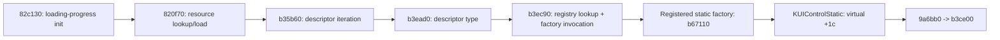

# SFrame loading-gauge rectangle and virtual data recipient

Verified **2026-11-01** on original x86 SFrame SHA-256 `27f42fc8f6b08df8c239640b938d601aeaebb7b3db0c89fc47755325a98a410d`. **REA 6.4.0 / Ghidra 12.1.4** retained **18 new function dossiers / 10,862 analyzed body bytes**, plus five focused containment/reference observations. This closes the concrete pointer-transfer question left in [the routing/alias report](SFRAME_STAT_ROUTING_RE.md). No original SFrame process was launched for this pass; observations below are static and do not attest a live widget instance.

At **0x0082cb97**, the pointer **parent+0x458** belongs to **SUILoadingProgressWnd** and addresses a saved **16-byte rectangle**. For the selected archived resource and the shipped/default `static` factory binding, the recipient is **KUIControlStatic** and virtual+0x1c resolves to **0x009a6bb0**. This path does not establish activation of **SUICharacterInfoWnd+0x458**; that main-window question remains unresolved.

[Versions](VERSIONS.md) remain RappelzRust/Core **0.1.0 development**, NoLimits launcher **1.3.60**, original SFrame PE **9.1.0.0**, embedded build lineage **Source9.5.2**, network literal/profile **201507080**. The exact official Epic/patch remains unconfirmed.

## Parent, rectangle and named child

Provider containment places 0x0082cb97 in **0x0082cb20–0x0082cc70**. The inline child construction in **0x0082b380** allocates **0x484 bytes**, installs vtable **0xd48548** with RTTI **SUILoadingProgressWnd**, and stores the object in its outer owner's+0x464. This provenance comes from assignment/call bytes, not a nearby symbol name.

The resource initialization virtual+d0 is **0x0082c130**. After its base resource loader it finds three exact names and saves their rectangles:

| Child name | Saved rectangle in SUILoadingProgressWnd |
|---|---|
| `loading_frame_01` | +0x448..+0x457 |
| `loading_frame_02` | **+0x458..+0x467** |
| `loading_frame_03` | +0x468..+0x477 |

The constructor's second saved rectangle initially contains **[415,639,417,658]**; successful initialization replaces it with the second child's geometry. The update 0x0082cb20 again looks up `loading_frame_02`, retains the returned object in **EDI**, then explicitly loads **ECX=EDI** before calling the already retained **0x00b3d010** wrapper. That wrapper forwards its argument to the receiver's virtual+0x1c, then returns receiver+0x108. The passed source address is not itself the receiver.

The fresh **0x00722270** accessor returns receiver+0x108 for a nonnull receiver and a guarded, initially zero static rectangle for null. The inspected update requires all three child lookups to succeed before this geometry work.

## Resource, factory and selected concrete slot

The selected original archive entry is **`window_lobby_loading_bar_gage.nui`**, data.002 offset **550,682,843**, **808 bytes**, selected by its original data.000 index row. Its resource payload restarts the original XOR key at phase0. Decrypted SHA-256 is **`09dde66ad032adb16dbe2231a689a8533eea8b4b4472c9f84e4818d13e9b0e47`**, byte-identical to the existing local cache. The 143-byte selected node declares:

| Field | Archived value |
|---|---|
| type | `static` |
| id | `loading_frame_02` |
| rectangle | `21,8,23,27` |

Original registration bytes at **0x005b67a0** bind `static` to factory **0x00b67110** through the shared registry. That factory allocates **0x2ec bytes**, initializes the base, and installs **KUIControlStatic** vtable **0xd8d0f0**. The valid slot **+0x1c →0x009a6bb0** is independently checked from original bytes and RTTI.

New native dossiers establish the selected descriptor creation path:

0x00820f70 passes its resource-name argument through the resource manager and supplies the resulting object to 0x00b35b60. That routine iterates parsed descriptors and calls 0x00b3ead0, which passes the descriptor's first string to 0x00b3ec90. The latter performs hash-plus-exact-name lookup and invokes the recovered factory callback; the created object is initialized through virtual+8 with that descriptor. This narrows the earlier initial-creation gap. Full parser grammar, original runtime resource/loose override precedence, registry mutations and current live receiver identity are not observed. The concrete factory/slot association is conditional on this archived/default construction profile.

Other analyzed consumers are explicitly separate: **0x00b378f0** clones/replaces two named existing children; **0x00b53830** uses a list-item template; **0x005b47f0** guards a factory registration; **0x00b3f4d0** constructs a programmatic `msgwnd`. Their registry use alone is not evidence of the selected NUI's initial loading.

## What the virtual rectangle operation does

**0x009a6bb0** calls **0x00b3ce00** with the supplied rectangle, then invokes its own virtual+0xdc. The base operation reads 16 bytes from the argument and copies them into the receiving control's **+0x108** and **+0x128** rectangle fields. Its optional child callbacks use virtual+0x2c with the same source pointer and size deltas. There is no direct write back to the supplied parent+0x458 rectangle in this inspected body; child effects are not globally excluded.

For the same static-control table, virtual+0xdc is **0x009a9030**, which invokes virtual+0xd0 and+0xd4(0). These secondary callback bodies are not all reconstructed in this pass. The source rectangle, destination control and enclosing loading-progress object remain distinct.

## Loading-progress geometry for finite inputs

The update 0x0082cb20 first stores its float argument at parent+0x480. If any of the three named children is absent, it returns false in **AL** without entering the successful geometry branches. Otherwise its inspected finite-input cases are:

| Input | Requested operation |
|---|---|
| p≤0 | Restore first/third saved positions and the second saved rectangle; store progress 0. |
| 0<p<1 | Copy the second control's current rectangle; replace right with **left − trunc(f32(p×−198.0))**; apply it and move the third control to that right/top. |
| p≥1 | Set the copied rectangle's right to **left+198**; apply it, move the third control, and store progress 1. |

The middle branch's single-precision multiply and **CVTTSS2SI** conversion are present in original instructions; it does not use rounding to nearest. The 1.0 and −198.0 constants are checked directly in the PE. These are this widget's UI coordinate values, not a terrain-loading throughput measure or a universal width for every resolution. No rendered result, timing, NaN/infinity policy or current reconstructed-client behavior is claimed from this static expression.

## Main-window comparison and remaining boundary

RTTI places the main character window in **SUICharacterInfoWnd → SUIWnd → KUIGenWnd → KUIWnd → KObject**. Its virtual+0x1c points to **0x00b36cb0** and+0x20 to the previously analyzed **0x00b36a30**. The base KUIWnd slots instead use 0x00b3ce00/0x00b3cdc0. The generic wrapper does not determine its receiver's class by itself.

The six statically inspected generic bodies have no fixed memory displacement+0x458 access, but this is not a whole-subtree absence proof. In 0x00b36cb0, an indexed read from receiver+0x334+i×16 can reach that offset when the count is large enough; the inspected resource count has no established global upper bound. Child callbacks and input pointers also retain separate limits. **0x00b37e10** copies/constrains the supplied rectangle; only caller provenance can identify what that pointer denotes.

The particular 82cb97 path is now typed as loading-progress rectangle transfer. The main CharacterInfo mode's nonzero activation still lacks a concrete writer; no global non-activation conclusion follows.

## New native Evidence and verification

| New function entry | Analyzed bytes | Role | Evidence ID |
|---|---:|---|---|
| 0xb36cb0 | 699 | Main/inherited rectangle virtual slot | `ev_d1c78eb1e366ec54558ca555fc7916d89244e357a120a72e91d7234db3b3dd84` |
| 0xb3ce00 | 106 | Base rectangle assignment | `ev_d17c41df8722f83e3acd6057df8198c5b70d0e043370b460174906ff9253c14f` |
| 0x82c130 | 146 | Loading-progress resource initialization | `ev_001940f99d4d2beb2de83be211df31242eaa881e72031087d4befd91dfb54798` |
| 0xb37e10 | 462 | Constrained rectangle copy | `ev_8062282ce070e8426ea1aea4e81f61950a7eae7decaeba7dc367f56daa0d8437` |
| 0x9a6bb0 | 29 | Static-control rectangle slot | `ev_ad7fd5709d89b57452c81e7ad13a12e1e9e8511fb76ad18c4d6bde7376e8a9f5` |
| 0xb67110 | 109 | Static-control factory | `ev_7ebc0497915501cf0499b1a452b680fafe0fcde49f19edb9452a99a8e61b6c2b` |
| 0x9a9030 | 25 | Static-control geometry notification | `ev_9e5ecf337e8acb93aa90b31101aba385d028b0b528920fe8e5e007dda03fa867` |
| 0x82cb20 | 337 | Loading-progress value/geometry update | `ev_f9fbbf2a0f29ef810802fbdb0d6e51e836de78cbb7325fc6d83b98eb74fbf4a0` |
| 0x82b380 | 3,491 | Outer loading-window setup and inline child construction | `ev_059c4c6a8ff46674c45c26e2f2d5b5077486a76eade319a36cc5aabedd55651a` |
| 0xb378f0 | 1,142 | Existing-child clone/replacement consumer | `ev_de1476ced73280bc1b46a029e3361021fc808d24fac18a934010c6707dff636e` |
| 0x5b47f0 | 296 | Factory bootstrap registration guard | `ev_82eeab58985f1334084cd6e88dc50f0f9ee813b138363ec2d44df49224002086` |
| 0xb53830 | 940 | List-item template factory consumer | `ev_f8998c1ee6852326b30acf046ed4976df7c8fbaa6b9ea10b1854e8b911142306` |
| 0x820f70 | 87 | SUIWnd resource-loading entry | `ev_bf6a01b950ce19ea40f7d2a5709725e5431a157e569999caec2f85e087de96e0` |
| 0xb35b60 | 552 | Resource descriptor iteration | `ev_780cd463050f07ecb6fc2124376fbcb2e95dd2a03b4f84435dcbface76076ff5` |
| 0xb3ead0 | 437 | Descriptor-driven object creation | `ev_5f57d5eeeef5a105042b0ceec3f79df05293b720c9fe47ae03fe6cc106e0f02f` |
| 0xb3ec90 | 354 | Factory lookup and invocation | `ev_ddc5747a3d5b8e234861260a575d82bcbd6db31a663dc92f6dd55a7ae6e2c860` |
| 0xb3f4d0 | 1,543 | Programmatic message-window creation | `ev_4a1afb98f58f8f38158285d632452edd89bf6bda725256ca975b43b758c25e7d` |
| 0x722270 | 107 | Nullable rectangle accessor | `ev_aa161205dcef806f5b9b3434ddc52fb69da13c6ce4614059ad175a72880e02ad` |

The reused 0x00b3d010 dossier is `ev_c7ca54f52266c9dddf39d7ed68f87f910726d84715119f87da75b86ce91b200d`. All 18 new native records match the original SHA and profile digest `b9d116ea480a02cc8773b19372074a3caf77785cbc080b1ac7133b5110e40b17`. Five fresh metadata queries retain three provider containment results, exact wrapper xrefs and incoming factory-lookup references. The first query took **433.09 seconds**, including default Ghidra startup; no new result-budget recovery was needed.

New value-flow graphs for **0x0082b380** and **0x00b3f4d0** are truncated, with **0 and 1 known omitted edges**, respectively, each reporting omitted-operation lower bound 1. The other 16 new graphs report untruncated. Indirect callbacks and type inference remain distinct from complete retained analyzed body ranges.

The final **85,578,672-byte canonical bundle** retains **100 Evidence records**: 77 imported and 23 new observations. The owned session is closed; its **170,934,576-byte snapshot** retains 91 primitive entries  / 100 records. Raw analysis and resource proofs stay ignored under `client-data/audit/2026-11-01-sframe-widget-data-f3d9e66e/`.

Verification checks **992 distinct original byte-range records**, including 16 selected geometry intervals/four RTTI classes, plus the original encrypted index row, payload, phase0 transform and cache equality. These overlapping byte checks are not 992 independently recovered functions. All **nine original data-preservation checks** pass; original/installed images, addon/WTF settings and primary service identities remain unchanged. Only documentation changes; no Rust behavior, schema, installed asset/binary or package version is modified. Historical gameplay/test counts are not new runtime results for this pass.

## Restart point

The selected virtual-recipient/rectangle question is answered for the archived/default construction path. Full NUI grammar, live overrides, complete callback effects and main alternate-mode activation remain open. Reuse this typed loading-progress path and its source/destination distinction; a future main-mode investigation needs a concrete CharacterInfo-instance writer or equivalent runtime evidence.

The next [CharacterInfo callback pass](SFRAME_CHARACTER_CALLBACKS_RE.md) recovers 15 fresh functions after a PC restart. It distinguishes name refresh, dimension caches and a separate list-context receiver, verifies child owner assignment and the shared base event delegation, and rechecks three original character-sheet resources. Main alternate-mode activation and exact fold/unfold action binding remain unresolved; reuse its newer closed snapshot for continuation.
